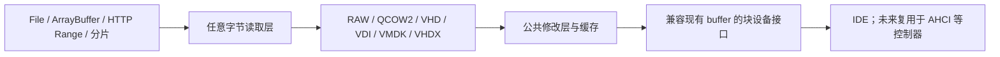

# 虚拟磁盘镜像格式支持计划

状态：P0、P1（第一轮完整交付）、P2、P3、P4 已实现并通过验收（P3 的差分镜像未开放）；P5 未实现。实施记录见[附录](#附录实施记录)。

本计划基于 2026 年 10 月 3 日审查的当前 v86 分支。目标是在现有 RAW 镜像能力上，
增加 QCOW2、VHD、VDI、VMDK 和 VHDX 的原生读取，并通过公共修改层支持客户机写入、
状态保存、持久化和导出。建议顺序为 QCOW2 → VHD 与 VDI → VMDK → VHDX。
此顺序是结合当前代码与实现复杂度的工程建议，不是各格式的市场占有率排名。

第一轮完整交付为 P0 与 P1：统一镜像接口、QCOW2 基础解析、客户机可写修改层、
状态保存恢复及数据一致性测试。后续再扩展压缩、父盘链和原格式写入。

## 格式范围

| 格式 | 主要生态与用途 | 特点 | 计划范围 |
| --- | --- | --- | --- |
| RAW，常见扩展名 `.raw`、`.img` | 通用磁盘镜像、QEMU、模拟器 | 顺序存放扇区，宿主文件系统可提供稀疏存储 | 保持现有兼容性，作为测试及导出基准 |
| QCOW2，`.qcow2` | QEMU/KVM | 按需分配、压缩、父盘链、快照、加密 | 首要新增目标，按特性分阶段支持 |
| VHD，`.vhd` | Virtual PC、Hyper-V 及历史镜像 | 固定、动态、差分磁盘 | 先固定和动态，差分后续加入 |
| VDI，`.vdi` | VirtualBox | 固定、动态，以及用于快照的差分镜像 | 与 VHD 同阶段推进 |
| VMDK，`.vmdk` | VMware | 单文件、分片、固定、稀疏、压缩及父子链等变体 | 按子格式公布兼容范围 |
| VHDX，`.vhdx` | Hyper-V | 大容量、512/4K 逻辑扇区、元数据日志、差分磁盘 | 先独立镜像与有限扇区配置，再完善日志和差分 |

上述格式与特性分别参见 [QEMU 镜像文档][qemu-images]、[Oracle 存储文档][oracle-storage]、
[VMware 磁盘类型][vmware-disks]、[VHD 规范][vhd-spec] 和 [VHDX 规范][vhdx-spec]。
扩展名只能作为提示，例如 `.img` 不一定是 RAW，`.vmdk` 也不能确定具体子格式。

以下对象单独安排，不混入块设备格式解析器：

- OVF/OVA 是虚拟机分发格式。OVA 通常将配置和磁盘装入 TAR 归档，导入器先解析配置、
  定位磁盘，再调用对应格式后端。参见 [Oracle 虚拟机导入导出文档][oracle-ovf]。
- ISO 是光盘镜像，继续使用现有光驱路径；本计划首轮只扩展硬盘镜像入口。
- QEMU、VMware 等软件的运行状态包含 CPU、内存与设备内部状态，不属于磁盘格式兼容。
  读取 QCOW2 当前活动磁盘不等于恢复其中保存的整机状态，也不等于实现内部快照切换。
- Parallels HDD、旧 QCOW、QED 等放入后续兼容候选，不列为首轮发布条件。

格式可读也不保证系统可启动。迁移还需检查 CPU 架构、BIOS/UEFI、控制器和客户机驱动。
当前分支已有 [x86-64 支持](x86-64.md)，应依据当前平台能力验证，不能套用旧版 v86 的限制。

## 当前代码基础

| 代码入口 | 当前情况 | 计划中的处理 |
| --- | --- | --- |
| [`src/buffer.js`](../src/buffer.js) | 支持 ArrayBuffer、File、HTTP Range、静态分片与 Zstd 分片；没有上述容器格式解析器 | 分离字节来源、格式解析和修改层；分片压缩不等同于 QCOW2 压缩簇 |
| [`src/browser/starter.js`](../src/browser/starter.js) | 接受带 `get/set/load` 的自定义后端，启动时预读 MBR | 硬盘初始化统一经过格式工厂，预读的是解码后的虚拟扇区 |
| [`src/browser/cpu_worker.js`](../src/browser/cpu_worker.js) | 镜像配置按固定字段转发，拒绝带方法的后端对象 | 转发可序列化描述，在 Worker 内构建解析器 |
| [`src/ide.js`](../src/ide.js) | 通过 buffer 访问扇区和保存状态；已有 LBA48，FLUSH 当前立即成功 | 复用扇区接口，补齐错误、异步写完成和 flush/barrier 语义 |
| [`src/state_io.js`](../src/state_io.js) | 跟踪客户机发起的在途 I/O | 新后端在成功、失败和取消时均正确结束跟踪 |
| [`v86.d.ts`](../v86.d.ts) | 声明现有镜像描述 | 增加格式及修改层配置，明确文件长度和虚拟容量的区别 |
| [`tests/devices/ide_large_disk.js`](../tests/devices/ide_large_disk.js) | 包含 3 TiB 虚拟磁盘与超过 `2^32` 扇区的访问用例 | 扩充新格式大偏移及容量报告测试 |

异步 buffer 的 `set()` 当前将修改保存在内存，状态保存只收集写过的块；同步 buffer
则保存整盘内容。此机制可以提炼为公共修改层，但它尚不提供浏览器存储持久化。
现有 3 TiB 用例仅覆盖特定路径，不代表任意 64 位磁盘容量都已得到支持。

[`src/browser/filestorage.js`](../src/browser/filestorage.js) 是 9p 文件系统的文件来源层，
不应作为虚拟硬盘容器解析的接入点。

## 架构



源镜像保持只读，客户机写入进入独立修改层（overlay）。读取时先检查修改层，再读取
格式解析器提供的基础数据。修改层以客户机可见的磁盘偏移为索引，不使用容器文件偏移。
客户机可以正常修改文件和重启，首版无需修改 QCOW2 的分配表、引用计数及快照元数据。

底层字节读取器提供文件长度、任意区间读取、取消和明确的错误结果。现有异步 buffer
要求 256 字节对齐，而格式头、表项和压缩数据不一定对齐；可增加对齐读取后切片的适配，
或提取底层传输能力。读取尾部时不能向文件外扩展对齐区间。

格式解析器提供虚拟容量、逻辑扇区大小和虚拟区间读取。面向设备的适配层继续满足
`load/get/set/byteLength/get_and_cache/get_from_cache/get_state/set_state` 等实际调用。
大镜像导出使用流式接口，不能依赖现有异步后端无法提供的整盘 `get_buffer()`。

## 配置契约

以下为拟议 API，当前不能直接使用：

```js
new V86({
    hda: {
        url: "disk.qcow2",
        format: "qcow2",
        async: true,
        disk_option: "read_only",
    },
    // 其余配置保持现有用法
});
```

- 新增 `format: "raw" | "qcow2" | "vhd" | "vdi" | "vmdk" | "vhdx" | "auto"`，
  只对已实现的格式开放。首轮支持 `raw/qcow2/auto`。
- 省略 `format` 保留现有 RAW 行为；显式格式优先于文件名。`auto` 使用格式签名和结构
  探测，必要时读取文件尾部，例如固定 VHD 的 footer。不能只检测文件头。
- `auto` 无法确定格式时要求显式指定；RAW 没有统一签名。已识别格式损坏或具有
  不支持的特性时直接报错，绝不静默退回 RAW。
- `size` 如提供，表示源文件字节长度；设备的 `byteLength` 来自解码后的虚拟容量。
  RAW 的两者相同，QCOW2 等容器通常不同。
- 写入策略由 `disk_option` 决定（[磁盘持久化计划](disk-persistence-plan.md)），取代此前
  拟议的 `overlay: "memory"`。新格式首轮只支持 `read_only`，即内存修改层；`read_write`
  写回源镜像需要 P5 的原格式写入，在此之前对非 RAW 镜像启动报错。持久化描述需包含
  稳定存储标识，不能复用 URL 或文件名充当唯一镜像身份。
- `hda/hdb` 的 URL、File、ArrayBuffer 路径都经过相同工厂，包括非异步 URL 完整下载后的
  路径。BIOS、初始状态、内核、软盘和光盘继续保留各自的加载语义。
- Worker 只接收数据描述，不跨线程传递解析器实例或解析回调。后续父盘和 VMDK extent
  通过显式来源映射传入，并在执行磁盘 I/O 的线程内解析。

## 实施顺序

| 阶段 | 工作内容 | 交付与依赖 |
| --- | --- | --- |
| P0 | 统一字节来源、格式工厂、修改层及错误契约；贯通配置和 Worker | RAW 行为保持兼容，成为后续各格式共同基础 |
| P1 | QCOW2 v2/v3 基础读取、客户机写入、状态保存恢复 | 与 P0 合成第一轮完整交付 |
| P2 | QCOW2 压缩与父盘链；流式 RAW 导出 | 分项交付，完整支持常见后续使用流程；持久化见[磁盘持久化计划](disk-persistence-plan.md) |
| P3 | VHD 与 VDI 固定和动态镜像 | 共用 P0 的基础；两个解析器可并行开发 |
| P4 | VMDK 常用子格式，再加入复杂变体和 OVF/OVA 导入 | 导入器依赖实际支持的磁盘子格式 |
| P5 | VHDX 和高级导出写回 | 在基础正确性稳定后，逐项开放能力 |

### P0 统一接口与公共行为

建立独立的镜像模块目录，按字节来源、格式解析器、修改层和设备适配器组织。
具体文件名在实现时确定；`buffer.js` 保留兼容入口，避免一次替换所有旧后端。
新模块需接入现有构建流程，并覆盖浏览器、Node、Worker 和非 Worker 路径。

对 I/O 成功、失败、取消和复位后的过期完成建立统一规则。格式错误和网络错误都必须
结束请求与在途计数，不能让初始化、设备命令或状态保存永久等待。共享在途读取允许
合并，但取消某个调用方不能无条件中止其他调用方仍需要的读取。

此阶段与 [SATA 的磁盘后端](sata.md#disk-backends) 协调，复用错误、
异步完成和 flush/barrier 契约。新格式支持不依赖 Q35 或 AHCI 先行完成。

验收：现有 RAW 的加载、读写、启动和状态恢复行为不变；新描述经过 Worker 传递后
不丢字段；失败和取消均可收敛；设备容量取自虚拟磁盘而不是源文件。

### P1 QCOW2 基础支持

实现 v2/v3 文件头校验、标准 L1/L2 地址映射，以及普通数据簇、未分配簇和零簇读取。
首版仅支持无父盘、未加密、无外部数据文件、标准 L2 的镜像；压缩簇在 P2 实现。
当前活动磁盘可读即可，不要求提供内部快照选择、创建或整机状态恢复。

已分配、未分配和显式零簇必须分别处理。首版无父盘时未分配区返回零，但不能把这条
规则直接用于后续父盘链。带父盘时，未分配区可回落父盘，显式零簇仍必须返回零。

对未知不兼容特性、未实现的扩展 L2、加密、外部数据文件和父盘需求明确拒绝。
首版策略也拒绝 dirty/corrupt 镜像，将一致性修复留给已有工具。
未知 compatible 位及可忽略的普通头部扩展按规范处理，不因其未知就拒绝；文件包含
内部快照也不妨碍读取当前活动磁盘，只是不提供快照切换能力。
压缩簇可能仅在 L2 表项上标记，不能只依靠文件头排除；按需读取首次遇到未支持的
压缩簇时返回明确 I/O 错误。打开时通过文件头检查不代表已验证所有未读取的数据簇。
格式语义参见 [QCOW2 规范][qcow2-spec]。

修改层覆盖跨簇写入、部分修改块更新、写后读和读写并发，较早开始的基础读取不能
覆盖较晚的客户机写入。状态保存包含修改块、状态格式版本、虚拟容量与基础镜像身份；
恢复前检查身份和布局，拒绝把修改应用到另一份镜像。

验收：基础格式矩阵与 RAW 基准逐字节一致；可运行已知兼容系统，修改文件、重启并
恢复状态；不支持的特性和损坏输入给出可定位错误，无静默错误数据。

### P2 压缩、父盘与导出

优先加入 raw-deflate 压缩簇，再加入 zstd。QEMU 文档中的 zlib 压缩簇没有 zlib 头，
必须选择正确的解压模式。现有 zstd 解压能力仅在输入和输出契约核实后复用。
解压结果需校验长度并限制资源消耗，解压工作放在不会阻塞页面的执行路径。

父盘链由调用方显式提供，校验格式、容量适配、镜像身份、循环引用及深度上限。
不直接按镜像内的路径任意加载文件或网络资源；缺失父盘不得当作零数据处理。
后续 VHD、VDI 差分和 VMDK 父子链共用来源管理，但保留各格式的身份与继承规则。
状态和持久化修改层绑定完整链的格式、容量和稳定来源身份，恢复前逐项校验。

持久化指写回绑定的源镜像，由[磁盘持久化计划](disk-persistence-plan.md)定义：写入的
“完成”与“持久”、FLUSH 与写缓存、快照规则、写者隔离和错误策略都在那里。独立保存的
持久修改层不作为 `read_write` 的实现；容器格式的写回依赖 P5 的原格式写入。内存模式
只兑现内存写入屏障，不能将其描述为跨会话持久化。

流式 RAW 导出读取格式解码后的数据与修改层合成结果，支持进度、取消和写入背压。
导出前暂停客户机并等待在途 I/O，或获取稳定的磁盘视图，避免拼出不同时刻的数据。
RAW 导出的逻辑长度为完整虚拟容量，应在开始前说明目标大小。

验收：压缩与父盘组合数据正确；基础镜像或父盘不匹配时拒绝恢复；导出数据与同一磁盘
视图一致。

### P3 VHD 与 VDI

VHD 先实现固定与动态类型，覆盖 footer/header 校验、块分配表和扇区位图语义。
VDI 先实现固定与动态类型，覆盖头部、块映射、数据偏移及未分配和零块语义。
两个解析器都使用公共修改层，不在此阶段直接修改原格式分配结构。

差分类型在各自身份与父盘继承规则完成后单独开放，不能因公共父盘读取已存在就默认
宣称支持。验收包括独立工具生成的样本、随机区间比对、跨块写入和状态恢复。

### P4 VMDK 与整机包导入

先实现 descriptor + flat extent 和单文件 `monolithicSparse`，再加入分片 extent、
`streamOptimized` 压缩及父子链。每种 createType 和 extent 类型都维护明确支持状态；
不得笼统宣称支持全部 VMDK。VMFS 特殊快照类型等另行评估。

多文件输入通过显式来源映射绑定，检查 extent 长度、偏移和覆盖范围。父盘链需按格式
规则核对 CID 等信息。`streamOptimized` 的读取与索引方案单独验证，不能假设它等同于
普通 sparse，也不能因支持常规 VMDK 就直接支持所有 OVA 包。

OVF/OVA 导入器解析归档、配置与磁盘关系，将可支持的硬件设置映射到 v86；对于不匹配
的架构、固件、控制器或设备给出具体信息。优先完成磁盘提取与挂载，再扩展自动配置。

验收：各声明支持的子格式在本地与 HTTP 路径一致；多文件缺失、父子不匹配和未知
子格式被明确拒绝；导入包中的磁盘内容与独立读取结果一致。

### P5 VHDX 与原格式导出

VHDX 需要处理双 header、校验和、region/metadata、BAT 状态和逻辑扇区大小。
首版限定无父盘、512 字节逻辑扇区且无需日志重放的镜像。4K 逻辑扇区必须在整个设备
路径支持并正确报告后才能开放，不能仅让解析器以 512 字节重新切片。

非空日志必须先重放；未实现重放时拒绝打开，即使源镜像按只读使用也不能跳过。
这一要求来自 [VHDX 日志重放规范][vhdx-log]。后续可研究在独立视图中重放，以保留
源文件只读策略，再扩展差分磁盘。

原格式写入与读取分别发布。先实现导出新的、受限特性的 QCOW2 文件，再考虑就地
更新已有镜像；后者需要正确维护分配表、引用计数、写入顺序、崩溃一致性和快照关系。
其他格式按实际需求增加导出或写回，不作为读取支持的前置条件。

验收：VHDX 块状态、日志拒绝或恢复、扇区配置均符合规范；新导出的镜像可被独立工具
检查并在 QEMU 等工具中读取，所有客户机可见扇区与稳定导出视图一致。

## 地址缓存与来源一致性

- 所有 64 位字段先用 `BigInt` 解析和掩码，转换为 `Number` 前检查安全整数与实际支持
  范围。偏移、长度、乘法和加法均校验；不使用 JS 的 32 位位运算计算大磁盘地址。
- 分别限制元数据缓存、解压缓存和数据缓存，不能按虚拟容量分配完整内存。修改块不能
  被普通缓存淘汰策略丢弃；内存模式达到预算时明确失败，或使用已配置的持久化后端。
- 合并重复及相邻读取，缓存 L1/L2、BAT 或 grain table，并测量网络往返和读取放大。
  不能为了启动而强制下载整盘，也不能通过跳过格式检查换取性能。
- HTTP 路径校验 Range 响应状态、Content-Range、实际长度和文件边界。来源在会话中
  变化时使缓存失效并停止继续混读；使用可信版本标识、强 ETag 或内容哈希建立身份。
- URL、本地文件名、长度或修改时间单独不足以证明是同一基础镜像。大文件采用发布时
  生成的可信清单或受控版本标识等方案，避免每次启动都为校验下载整个镜像。

## 验收矩阵

测试以独立工具转换出的 RAW 为基准，系统成功启动不能替代数据正确性验证。
使用 [qemu-img][qemu-img] 创建和转换受控样本，记录生成命令、工具版本和样本校验和；
必要时加入厂商工具生成的样本。qemu-img 用于开发、校验和临时转换，不作为浏览器
运行时依赖，也不要求把完整 QEMU 镜像栈移植进首版。

| 范围 | 必测内容 |
| --- | --- |
| 格式读取 | 每种已开放版本和子格式；普通、稀疏、零块；首末扇区、跨块、跨簇、随机区间 |
| 容量与地址 | 容器小于虚拟容量；超过 4 GiB 的偏移；跨 `2^32` 扇区边界；超出安全整数范围的拒绝 |
| 写入修改层 | 写后读、部分块更新、跨簇写入、并发读取与写入、内存预算失败 |
| 状态与生命周期 | 保存恢复、底图身份不匹配、在途 I/O 等待、复位取消、迟到回调、导出一致视图 |
| 来源 | ArrayBuffer、File、完整下载、HTTP Range、静态分片；截断、错误区间和来源变化 |
| 运行入口 | Node、浏览器 CPU Worker、浏览器非 Worker；构建产物和类型声明一致 |
| 特性与错误 | 未知不兼容特性、损坏结构、非法偏移、缺父盘、链循环、未支持压缩和逻辑扇区 |
| 持久化 | 见[磁盘持久化计划](disk-persistence-plan.md#验收矩阵) |
| 客体回归 | 已知兼容系统的安装或启动、文件写入、重启及状态恢复；旧 RAW 路径保持通过 |

复用 [`tests/devices/ide_large_disk.js`](../tests/devices/ide_large_disk.js)、
[`tests/devices/device_io_reset.mjs`](../tests/devices/device_io_reset.mjs) 和
[`tests/api/state.js`](../tests/api/state.js)，新增独立格式解析与传输测试。
性能记录冷启动读取字节数、请求数、元数据缓存命中和峰值内存，与同内容 RAW 对照；
验收阈值在取得基线后确定，不预先宣称性能提升。

## 参考资料

- [QEMU 镜像格式与选项][qemu-images]
- [QCOW2 文件格式规范][qcow2-spec]
- [qemu-img 使用文档][qemu-img]
- [Oracle VirtualBox 存储格式][oracle-storage]
- [Oracle VirtualBox 导入与导出][oracle-ovf]
- [VMware 虚拟磁盘类型][vmware-disks]
- [Microsoft VHD 规范][vhd-spec]
- [Microsoft VHDX 规范][vhdx-spec]
- [Microsoft VHDX 日志重放要求][vhdx-log]

[qemu-images]: https://www.qemu.org/docs/master/system/images
[qcow2-spec]: https://www.qemu.org/docs/master/interop/qcow2.html
[qemu-img]: https://www.qemu.org/docs/master/tools/qemu-img.html
[oracle-storage]: https://docs.oracle.com/en/virtualization/virtualbox/7.2/user/storage.html
[oracle-ovf]: https://docs.oracle.com/en/virtualization/virtualbox/7.0/user/Introduction.html
[vmware-disks]: https://developer.broadcom.com/xapis/virtual-disk-api/latest/vddkDataStruct.5.3.html
[vhd-spec]: https://www.microsoft.com/en-us/download/details.aspx?id=23850
[vhdx-spec]: https://learn.microsoft.com/en-us/openspecs/windows_protocols/ms-vhdx/83e061f8-f6e2-4de1-91bd-5d518a43d477
[vhdx-log]: https://learn.microsoft.com/en-us/openspecs/windows_protocols/ms-vhdx/0d588e33-23a6-4c71-b27f-87d97ac3e914

## 附录：实施记录

实施在 `disk-formats` 分支（自 `master` 79c37884），按“实施顺序”逐阶段提交。测试样本由
[`tests/image/samples.mjs`](../tests/image/samples.mjs) 用 Homebrew 的 qemu-img/qemu-io 10.2.0
生成到 `build/disk-image-samples/`，每次生成的命令、工具版本和 SHA-256 写在其中的
`manifest.json`；设备与客体测试用 [`tests/image/tiny_qcow2.mjs`](../tests/image/tiny_qcow2.mjs)
在内存中构造 QCOW2，不依赖 qemu-img。测试入口：`make disk-image-tests`（需 qemu-img）、
`make disk-image-browser-tests`（无头 Chrome）；设备与客体测试也加入了 `devices-test` 与
`api-tests`。

### P0 统一接口与 P1 QCOW2 基础支持（f9b4460b）

**实现。** 新目录 `src/image/`：

| 文件 | 内容 |
| --- | --- |
| `source.js` | 字节来源：`MemorySource`（ArrayBuffer、完整下载）、`BlobSource`（File；CPU Worker 中用 `FileReaderSync` 同步读）、`URLSource`（浏览器 HTTP Range，Node 本地路径）、`PartsSource`（`use_parts` + `fixed_chunk_size`，含 `.zst` 分片）、`CachedSource`（64 KiB 窗口读缓存，默认 32 MiB，相邻缺失窗口合并为一个请求，在途窗口共享，按调用方引用计数取消）；错误类型 `DiskImageError`（`kind`：io、corrupt、unsupported、changed、config） |
| `overlay.js` | 公共修改层 `WriteOverlay`：以客户机偏移为索引，256 字节块装入 16 MiB 分块，与 `AsyncXHRBuffer` 布局相同；可设预算，写入先检查预算并分配所需分块，失败时整块写入不生效 |
| `disk_image.js` | `ImageReader`：格式只需给出 `map()`（区间映射为数据、零、父盘、压缩簇四类 extent），读取、越界补零、父盘回落、压缩簇解压缓存由公共代码完成；`DiskImage`：设备侧适配，满足 `load/byteLength/get/set/get_and_cache/get_from_cache/get_state/set_state`，并有 `check_state` |
| `qcow2.js` | v2/v3 头部与扩展、L1/L2 映射、数据/未分配/零簇；按计划拒绝的特性见下 |
| `factory.js` | 描述校验（`format`、`disk_option`）、签名与结构探测（`auto`，含文件尾的 VHD footer）、来源构建、打开 |
| `sha256.js` | 同步 SHA-256，用于镜像元数据身份 |

接入：[`starter.js`](../src/browser/starter.js) 中 `hda/hdb/attach_sata_drive` 带 `format`（非 `raw`）时经
`create_disk_image` 构建，其余仍走 `buffer_from_object`；软驱、光驱、BIOS 等设置 `format` 报错。
打开失败经 `emulator-error` 结束启动（旧 RAW 后端 `load()` 返回的拒绝也一并收敛，此前是未处理的
Promise 拒绝）。[`cpu_worker.js`](../src/browser/cpu_worker.js) 转发 `format/disk_option/image_id/overlay_limit/backing`，
在 Worker 内构建解析器。[`ide.js`](../src/ide.js) 的 `read_buffer`、`write_to_backend` 和 FLUSH 增加错误
通道：读写失败按 QEMU `ide_rw_error` 置 ERR 并在错误寄存器置 ABRT，DMA 命令同时置总线主控错误位，
ATAPI 报 MEDIUM ERROR（ASC 11h）；[`ahci.js`](../src/ahci.js) 的 NCQ 读写失败经 `ncq_failed`（ABRT）。
[`cpu.js`](../src/cpu.js) 的 `validate_state` 在恢复任何状态之前核对每块硬盘的状态与本机镜像
（`validate_disk_states`）。`disk_option`：`read_only` 接受；`read_write` 尚未实现，启动报错；写在非盘项上报错。

QCOW2 拒绝的情况：版本 2/3 以外、`cluster_bits` 不在 9–21、虚拟容量非 512 的倍数或超出安全整数、
加密（`crypt_method` 或加密头扩展）、外部数据文件（特性位或扩展）、extended L2、未知不兼容位、
dirty 与 corrupt 位、父盘（P1 中；P2 由调用方提供）、L1 不足或越界或未对齐、L1 项保留位；读到时
报错的：L2 表越界、L2 项保留位、数据簇未对齐、v2 镜像的零标志、压缩簇（P2 实现）。未知 compatible
与 autoclear 位、未知头部扩展、内部快照不影响读取当前活动磁盘。

**偏差。**

1. 读取回调的错误放在第二个参数：成功 `fn(data)`，失败 `fn(undefined, error)`；写入和 flush 为
   `fn(error)`，与[磁盘持久化计划](disk-persistence-plan.md)的后端契约一致，但读取与其表中的
   `fn(error, data)` 不同。原因：旧 buffer 以 `fn(data)` 回调，错误后置时所有现有消费者（包括 `arm64`
   分支的 `block_backend.js`、`virtio_blk.js`）成功路径不变；错误前置时，未改动的消费者会把 Error
   当作数据，而 `TypedArray.prototype.set` 对没有 `length` 的对象静默不写，会产生静默错误数据。
   D0 实施时沿用此约定即可。
2. 64 位字段按计划用 `BigInt` 解析和掩码，但构建使用的 Closure Compiler v20210601 不接受 bigint 的
   按位运算类型，故运算经 `big()` 辅助函数（类型标为 `?`）进行，语义不变。
3. 计划允许“对齐读取后切片的适配”或“提取底层传输能力”，实现选了后者：新来源支持任意区间，读取
   尾部不越过文件长度。省略 `format` 或 `"raw"` 时仍用 `src/buffer.js` 原有后端，读写、请求与快照
   格式不变。
4. 数据簇落在文件末尾之外的部分读为零，与 QEMU 一致（簇尾可能从未写入，QEMU 会跳过全零的 COW
   区域）；元数据（头部、L1/L2 表、父盘名）越界则报错，这一点比 QEMU（越界的 L2 表读零）严格。
5. 镜像身份 = 格式、虚拟容量、文件长度、元数据 SHA-256（QCOW2：头部、扩展区与父盘名，L1 表）、
   可选的 `image_id`（发布者给出的版本标识），父盘链逐层包含。URL、文件名和 ETag 不计入身份，
   以免同一镜像换服务器或 CDN 后快照失效；ETag/Last-Modified 只用于会话内的来源变化检测。已分配簇
   被就地改写而元数据不变的情况需要 `image_id` 才能发现，已写入类型声明。
6. `overlay_limit`（修改层内存预算）默认不设上限，与现有 RAW 相同；内存分配失败也作为写错误返回，
   不再让分配异常穿过设备代码。

**测试结果。**

| 测试 | 结果 |
| --- | --- |
| `tests/image/qcow2.mjs` | 8 个 qemu-img 样本（v2/v3、512 B/4 KiB/64 KiB/2 MiB 簇、zlib/zstd 压缩）各经本地文件分段读和内存两条路径，整盘逐 MiB 与 qemu-img 转出的 RAW 比对并加 303 个随机区间，共比对 640 MiB；内存路径同步完成；`io.qcow2`（保留分配与取消分配的零簇、discard、部分簇写入、内部快照，读当前活动磁盘）；3 TiB 镜像在 4 GiB 以上与 2^32 扇区边界处比对；extended L2、外部数据文件、LUKS 加密被拒绝；16 种损坏头部各报出具体原因；未知 compatible/autoclear 位与未知扩展被忽略；L2 越界、保留位、未对齐、v2 零标志在读取时报错；`auto` 探测与 RAW 必须显式指定。压缩样本中压缩簇在 P1 报 `unsupported` |
| `tests/image/disk_image.mjs` | 跨簇与部分簇写入、写后读、覆盖层同步读、`get_from_cache`；先开始的读取在后来的写入之后完成时返回新数据，下次读取亦然；预算外写入整体失败；快照只恢复到同一镜像（文件与内存来源身份相同），另一镜像（v2 同内容）、`image_id` 不同、RAW 状态、快照无此盘、非法块号均拒绝；读缓存取消、共享、相邻合并与错误；HTTP：非 206、Content-Range 不符、长度不足、Content-Encoding、ETag 变化后不再发请求、网络错误重试 3 次后失败；分片跨块读；来源错误与打开失败均结束请求；选项校验 |
| `tests/devices/ide_disk_image.js` | 3 TiB QCOW2（文件 720896 字节）IDENTIFY 报虚拟容量；READ/WRITE SECTORS EXT 跨 2^32 扇区，镜像不变；损坏簇 ERR/ABRT 后下一命令正常；预算外写入 ERR/ABRT；快照恢复；另一镜像、RAW 机器在恢复任何状态前拒绝（内存不变）；本地文件分段读时快照等待在途读取，复位丢弃在途读取；非本格式镜像触发 `emulator-error` |
| `tests/devices/ahci.js`（新增一项） | QCOW2 盘的 DMA 读；NCQ 读与 DMA 读损坏簇、预算外 NCQ 写均 TFES + ABRT，读 NCQ 错误日志后恢复；31/31 通过 |
| `tests/api/disk-image.js` | MS-DOS 6.22（`msdos622.img` 的非零簇构成的 QCOW2，66322432 字节）从分段读取的文件启动，i440FX（IDE）与 Q35（AHCI）上各写文件、重启后文件仍在、恢复快照后其后写的文件消失、之前写的仍在；镜像文件 SHA-256 不变 |
| 浏览器（`tests/image/browser_runner.mjs`，无头 Chrome） | 页面与 CPU Worker 中 QCOW2 经 HTTP Range 启动 MS-DOS、写文件、快照恢复；非本格式镜像在两种模式下都触发 `emulator-error`。冷启动到 `C:\>`：30 个请求、1900546 字节，镜像 66322432 字节（约 2.9%） |
| 回归 | `ide_large_disk`、`device_io_reset`、`ahci`、`ahci_lifecycle`、`disk_write_cache`（10/10）、`api/state`、`cdrom-insert-eject`、`floppy`、`destroy-during-init`、`clean-shutdown` 通过；`build/libv86.js`、`build/libv86.mjs`、`build/cpu-worker.js` 的 Closure 检查 0 错误；eslint 无输出 |

样本（qemu-img 10.2.0；LUKS 样本含随机盐，每次不同）：

| 样本 | 字节 | SHA-256 |
| --- | --- | --- |
| `v3.qcow2` | 39911424 | `73be618768a02cb4…` |
| `v2.qcow2` | 39911424 | `a3b0b16b198f95e4…` |
| `v3-512.qcow2` | 34641920 | `07070f977e59c4b0…` |
| `v3-2m.qcow2` | 77594624 | `fa7cce44de9ceb90…` |
| `v2-4k.qcow2` | 33980416 | `822924d9a449c4ed…` |
| `v3-zlib.qcow2` | 23986176 | `78425dd426636a5a…` |
| `v3-zstd.qcow2` | 23920640 | `113019047b62185b…` |
| `v2-zlib.qcow2` | 23986176 | `ae560f25e72ecbb0…` |
| `io.qcow2` | 40435791 | `013f827b7bfe43f1…` |
| `child.qcow2` | 655360 | `ec195f96a36be658…` |
| `child-raw.qcow2` | 1441792 | `05b0135b40627f9b…` |
| `3t.qcow2` | 983040 | `ab9d3e313f55ca32…` |

性能：只记录了计数（请求数、字节数），未做计时测量（同机有长时间门禁运行）。

### P2 压缩、父盘与导出（447ff6bc）

**实现。**

- 压缩簇：raw deflate 用 [`src/virt/inflate.js`](../src/virt/inflate.js) 解压，`inflate` 增加输出上限参数
  （到一个簇即停，压缩数据所在最后一个扇区的其余字节不读入，与 QEMU `qcow2_zlib_decompress`
  相同），并补了损坏输入的检查（stored 块 NLEN、输入不足、距离超出已输出数据、非法长度/距离码、
  码长重复越界），原先这些情况会静默输出错误数据。zstd 用 CPU 核心中已有的解码器
  （`zstd_read`）：`disk_image_settings` 中的包装检查空指针、指针按无符号处理并总是释放上下文；
  调试版核心对坏数据 panic，也转成 I/O 错误。解压结果必须正好一个簇，否则报错；解压结果按 8 MiB
  上限缓存，同一簇的并发读取共享一次解压。
- 父盘链：由描述的 `backing` 显式给出（可嵌套，最多 16 层），不按镜像内的路径加载任何文件或网址；
  镜像需要父盘而未给出、给了父盘而镜像没有、`backing` 的格式与镜像记录的父盘格式（`vpc` 视为 `vhd`）
  不符、链中重复（同一对象、URL 或 buffer）均报错。父盘可以是 RAW（`RawReader`）。父盘比子盘小时
  超出部分读为零，显式零簇不回落父盘。身份逐层包含父盘的身份；`image_id` 改为每层各自记录。
  Worker 递归转发 `backing`。
- 流式 RAW 导出：[`src/image/export.js`](../src/image/export.js) 按不超过 1 MiB 的块顺序读取（格式解码
  加修改层），等待写入回调返回的 Promise（背压），报告进度，可用 `AbortSignal` 取消。
  `V86.export_disk_image(name, { write, progress, signal })` 经 `v86.export_disk` 在
  `state_transaction` 内执行：先暂停 CPU 并等待在途磁盘 I/O，导出的是同一时刻的磁盘视图，之后恢复
  运行。`disk_image_info(name)` 在开始前给出目标大小（虚拟容量）、格式、文件长度与修改层字节数。
  CPU Worker 中块经 MessagePort 逐块传给页面并等待页面写完；取消时下一块的写入失败，导出结束。
  页面的 “Get hard disk image” 对容器格式的硬盘改用导出（各块组成 Blob 下载）。

**偏差。**

1. “解压放在不会阻塞页面的执行路径”：CPU Worker 中解压在 Worker 内进行；`cpu_worker=0` 时模拟器
   本身就在页面线程运行，解压同样在页面线程（一个 64 KiB 簇约在毫秒以内），没有另设解压 Worker：
   异步解压会让本可同步完成的读取推迟到下一个时间片（对 SeaBIOS 轮询的 AHCI 影响见
   [sata.md](sata.md#disk-backends)）。
2. QEMU 的 deflate 与 zstd 簇都没有校验和：簇内数据的位错误大多解出另一份同长度数据而不报错
   （`tests/image/inflate.mjs` 中 300 次单比特翻转里 297 次如此），与 QEMU 相同，无法在格式层面
   发现；结构性损坏（截断、越界、帧头错误、copied 标志）均报错。
3. QCOW2 没有父盘身份字段（只有父盘文件名与格式）。父盘的匹配只检查格式；文件名不比较（同一镜像
   可能换名或换网址提供），仅出现在错误信息中。快照恢复时父盘的元数据身份必须一致。
4. 导出没有使用写时复制的稳定视图，而是计划给出的另一做法：导出期间暂停客户机。大盘导出期间客户机
   不运行。

**测试结果。**

| 测试 | 结果 |
| --- | --- |
| `tests/image/inflate.mjs` | 与 zlib 的 raw deflate 在 0/1/6/9 级、5 类数据上逐字节一致，含上限截断与流后附加字节；gunzip；截断、NLEN、保留块类型、越界距离报错 |
| `tests/image/qcow2.mjs` | 压缩样本（v3 zlib、v3 zstd、v2 zlib）与其余样本一样整盘与随机区间比对通过，共比对 1024 MiB（Node 中 zstd 用 zlib 的解码器按帧解码）；`io.qcow2` 中 qemu-io 压缩写入的簇；父盘：QCOW2 子盘（零簇遮住父盘数据）、比子盘小的 RAW 父盘、压缩父盘之上的子盘、`convert -c -B` 生成的压缩子盘，均与 qemu-img 转出的 RAW 一致；缺父盘、多余的父盘、父盘格式不符、自身为父盘、17 层，均报错；同内容同字节的父盘身份相同，同数据不同簇大小的父盘身份不同；压缩簇截断、越界、带 copied 标志报错；经模拟器核心的 zstd 解码器读出 63 MiB 与基准一致，帧头损坏的簇为 I/O 错误且之后读取正常 |
| `tests/image/disk_image.mjs` | 导出：写入后的整盘 RAW 与预期一致，一次一块（背压）、块不超过 1 MiB、进度从 0 到总长、第 3 块后取消；带父盘的快照只恢复到同一父盘，换成同数据的另一父盘被拒 |
| `tests/devices/ide_disk_image.js` | `export_disk_image` 在在途读取完成后才开始，内容含客户机写入；`disk_image_info` 报格式、容量、文件长度、写入字节数；无此盘报错 |
| `tests/api/disk-image.js` | i440FX 与 Q35 上 MS-DOS 写文件后导出 67108864 字节，含文件内容，与 `msdos622.img` 相差 4 个扇区 |
| 浏览器（页面与 CPU Worker） | 写入前导出的 SHA-256 等于 `msdos622.img`；写入后的导出含文件内容；hdb 为压缩（deflate）子盘、父盘为 zstd 压缩镜像，经 HTTP Range 读取并导出，SHA-256 等于 qemu-img 转出的 RAW；两次导出与 hdb 导出共读取 msdos622.qcow2 181 次请求 132317186 字节、v3-zstd.qcow2 244 次请求 23527426 字节 |
| 回归 | `ide_large_disk`、`device_io_reset`、`ahci`（31/31）、`disk_write_cache`（10/10）通过；Closure 检查（`libv86.js`、`libv86.mjs`、`cpu-worker.js`）0 错误；eslint 无输出 |

样本增加 `child-of-zlib.qcow2`、`child-zlib.qcow2`（样本版本 3）。

### P3 VHD 与 VDI（a2015551）

**实现。** [`src/image/vhd.js`](../src/image/vhd.js)：footer（动态盘用文件开头的副本，与 QEMU 相同；固定盘
用文件末尾的，兼容旧工具的 511 字节 footer）与动态盘头部的校验和都必须正确；虚拟容量按 QEMU vpc
驱动的规则：创建者为 `vpc `、`qemu` 时取 CHS 几何（几何为最大值 65535/16/255 时除外），其余（Hyper-V
的 `win `、`qem2`、Disk2vhd 等）取 footer 的当前大小，上限 2040 GiB；BAT 表项为 `0xFFFFFFFF` 的块读为零，
已分配块读块内数据（扇区位图之后）。固定盘的数据必须完整位于 footer 之前。
[`src/image/vdi.js`](../src/image/vdi.js)：1.1 版头部（预头部 0x48 字节之后 0x180 字节）、块映射，未分配
（`0xFFFFFFFF`）与已丢弃（`0xFFFFFFFE`）块读为零，数据块在 `offset_data + 序号 × 1 MiB`；与 QEMU 一样
只接受 512 字节扇区、1 MiB 块、无块附加数据，块号不得超出镜像块数。`format` 接受 `"vhd"`、
`"vpc"`（QEMU 的名称）、`"vdi"`；`auto` 由文件头或文件尾（固定 VHD）的签名识别。身份：VHD 为 footer、
动态头部与 BAT，VDI 为头部与块映射。两个解析器只给出 `map()`，修改层、状态、导出复用 P0–P2。

拒绝：VHD 差分盘（类型 4）与其他类型、footer 或头部版本不是 1.x、块大小不是 2 的幂、BAT 不足以
覆盖容量或越界；VDI 非 1.1 版、undo/差分类型（3、4）、带父或链接 UUID 的镜像、块大小或扇区大小
不符、块附加数据、容量超出块数、映射表或数据偏移未按扇区对齐、映射表越界。

**偏差。**

1. 差分 VHD 与差分 VDI 未开放（计划：“差分类型在各自身份与父盘继承规则完成后单独开放”）。本机的
   qemu-img 不能生成这两种镜像（QEMU 的 vpc、vdi 驱动都不支持差分），没有独立工具生成的样本，
   无法按验收矩阵验证父盘 UUID、时间戳与扇区位图的继承规则；需要 Hyper-V/Virtual PC 与
   VirtualBox 生成的样本（见报告）。打开这类镜像时报 `unsupported`。
2. 动态 VHD 的已分配块按 QEMU 的做法读取块内数据，不按扇区位图把未标记扇区读为零：规范要求新分配
   块的数据区为零，两种读法对符合规范的镜像结果相同；以 QEMU 为准使 qemu-img 转出的 RAW 可以作为
   基准。扇区位图将用于差分盘。
3. VHD 没有超过 2^32 扇区的容量（上限 2040 GiB），大偏移用 100 GiB 动态盘验证；VDI 用 3 TiB 动态盘
   验证 2^32 扇区边界。

**测试结果。**

| 测试 | 结果 |
| --- | --- |
| `tests/image/vhd_vdi.mjs` | qemu-img 生成的动态 VHD（CHS 容量 67125248 字节与 `force_size` 的精确容量）、固定 VHD（两种容量）、动态与固定 VDI，各经本地文件分段读和内存两条路径，整盘与 203 个随机区间与 qemu-img（`-f vpc`/`vdi`）转出的 RAW 一致，共比对 768 MiB；`auto` 识别、`vpc` 别名；100 GiB 动态 VHD 在 5 GiB 与末尾、3 TiB 动态 VDI 在 4 GiB 以上与 2^32 扇区边界处与写入内容一致；VHD 的 footer/头部校验和错误、头部签名、差分盘、类型 5、版本、块大小、BAT 过小或越界、截断的固定盘，VDI 的签名、版本、类型 3/4、块大小、块附加数据、父 UUID、容量超出、偏移未对齐、映射表越界、块号越界，均报出具体原因；未分配与已丢弃块读为零 |
| `tests/image/guest.mjs`（新） | qemu-img 把 `msdos622.img` 转为压缩 QCOW2、动态 VHD、固定 VHD、VDI，MS-DOS 均从分段读取的文件启动，写文件，重启后与快照恢复后文件都在，镜像文件不变 |
| 回归 | `tests/image/disk_image.mjs`、`tests/api/disk-image.js`、浏览器测试（CPU Worker）通过；Closure 检查 0 错误；eslint 无输出 |

样本增加 `dynamic.vhd`、`dynamic-force.vhd`、`fixed.vhd`、`fixed-force.vhd`、`100g.vhd`、`dynamic.vdi`、
`static.vdi`、`3t.vdi`（样本版本 5；VHD footer 含时间戳，每次生成的 SHA-256 不同）。

### P4 VMDK 与整机包导入

**实现。** [`src/image/vmdk.js`](../src/image/vmdk.js)。各 createType 与 extent 类型的支持状态：

| createType | 文件 | 状态 |
| --- | --- | --- |
| `monolithicSparse` | 一个 hosted sparse 文件（`KDMV`），描述符在文件内 | 支持 |
| `streamOptimized` | 同上，grain 经 zlib 压缩并带 marker；grain 目录位置在头部（qemu-img）或文件尾的 footer（`GD_AT_END`，VMware） | 支持 |
| `monolithicFlat`、`vmfs` | 描述符文件与一个 FLAT/VMFS extent | 支持（`files`） |
| `twoGbMaxExtentSparse`、`twoGbMaxExtentFlat` | 描述符文件与多个 2 GiB extent | 支持（`files`） |
| 无描述符的单个 sparse extent | 其容量 | 支持 |
| `vmfsSparse`、`vmfsThin`、`seSparse`、`vmfsRaw`、`vmfsRDM`、`fullDevice`、`partitionedDevice`、`custom` 等，ESX 的 `COWD` | | 拒绝（`unsupported`） |

extent 类型 FLAT、VMFS、SPARSE、ZERO，访问 RW、RDONLY；NOACCESS、VMFSSPARSE、VMFSRDM、VMFSRAW 与
无法解析的 extent 行拒绝。sparse extent：版本 1–3、grain 大小（2 的幂，8 扇区以上）、每表项数（不超过
512）、grain 目录与表在文件内；表项 0 为未分配（父盘或零），zeroed-grain 特性下表项 1 为零 grain；压缩
grain 读 marker 中的长度，校验 zlib 头和 Adler-32（与 QEMU 所用 zlib `uncompress` 相同）。FLAT extent
必须完整位于其文件内，各 extent 长度之和为虚拟容量。多文件镜像的其余文件由描述的 `files` 按名称（或
去掉目录后的名称）显式给出，不按描述符中的名字自行加载；镜像在 TAR 归档中时，按名称取同一归档中的
文件。子盘（`parentCID` 不为 `ffffffff`）需由 `backing` 给出父盘，父盘必须是 VMDK 且其 `CID` 等于子盘的
`parentCID`（QEMU 同样只接受 VMDK 父盘）。

[`src/image/ova.js`](../src/image/ova.js)：TAR 读取（ustar 前缀、GNU 长文件名、PAX 扩展头，头部校验和）；
不依赖 DOMParser 的小型 XML 解析器（Worker 与 Node 中没有 DOMParser）；OVF：References、DiskSection
（容量单位 `byte * 2^n` 及常见名称）、VirtualHardwareSection 的处理器、内存、IDE/SATA/SCSI 控制器与
硬盘挂接、网卡、声卡、USB，VMware 的 `firmware` 配置与 VirtualBox 的 `Firmware` 元素，操作系统说明。
`V86.import_ova(file)` 在创建机器之前读取归档，返回 OVF 文本、归档文件列表、磁盘（每块带一个
`{ url | buffer, archive_member, format }` 描述，直接在归档中读取，不解包）、建议的 V86 选项
（`memory_size`、`cpu_cores`、有 SATA 盘或多于两块盘时 `machine_type: "q35"`、`hda`、`hdb`），以及
v86 没有的硬件说明：SCSI 控制器（其盘改挂 IDE/AHCI）、网卡型号（v86 只有 NE2000 与 virtio-net）、
声卡、USB、EFI 固件（v86 为 SeaBIOS）、ARM 客体、多于两块盘、文件不在归档中或被压缩的磁盘。
描述的 `archive_member`、`files` 经 Worker 递归转发。

**偏差。**

1. qemu-img 生成的 streamOptimized 把 grain 目录位置写在头部，不写 footer；`GD_AT_END` 与 footer
   （VMware ovftool 的写法）的读取用由 qemu-img 样本改写出的镜像验证（加 footer marker、footer 与流结束
   marker），没有 VMware 工具生成的样本。
2. 超过 2^32 扇区的 VMDK 未验证：qemu-img 生成 3 TiB 的 sparse VMDK 时预先写入全部 grain 表（约
   400 MB），超出本机样本的空间约束；大偏移以 100 GiB sparse 与 5 GiB 分片（跨 2 GiB extent 边界）验证。
3. `vmfs` createType 只用手写描述符（VMFS、ZERO 与带偏移的 FLAT extent）验证，qemu-img 不生成它。
4. OVF 的清单文件（`.mf`）中的校验和未核对；OVF 中压缩（`ovf:compression`）的磁盘文件不读取，以说明
   列出。自动配置只给出建议选项，不直接启动机器。

**测试结果。**

| 测试 | 结果 |
| --- | --- |
| `tests/image/vmdk.mjs` | qemu-img 的 monolithicSparse、streamOptimized、monolithicFlat、twoGbMaxExtentSparse、twoGbMaxExtentFlat 与 zeroed-grain 镜像，各经本地文件与内存两条路径整盘及随机区间与基准一致，共比对 896 MiB；`auto` 识别描述符文本与 `KDMV`；零 grain 为零 extent；5 GiB 的 2 GiB sparse/flat extent 在 extent 边界与末尾、100 GiB sparse 在 5 GiB 处与写入内容一致；子盘与父盘的读取与 qemu-img 一致，缺父盘、CID 不符、父盘为 QCOW2 均拒绝；`vmfs` 描述符跨 VMFS/ZERO/FLAT 三个 extent 的读取；不支持的 createType、NOACCESS、VMFSRDM、无法解析的 extent 行、未给出的 extent 文件、过短的 flat 文件、sparse 版本 4、grain 大小、表项数、grain 目录或表越界、footer 或流结束 marker 损坏、Adler-32 不符、marker 长度越界均报错，其余 grain 仍可读；按名称（不含目录）找到 extent 文件 |
| OVA（同一测试） | bsdtar 生成的 ustar 与 pax 归档（OVF + streamOptimized 磁盘）：文件列表、两块盘（其一文件不在归档中）、控制器、容量、内存与 CPU 数、5 类说明；归档中的磁盘（文件与内存来源）与基准一致；归档中没有的文件报错；OVF 单位换算、VirtualBox 固件、XML 错误 |
| `tests/image/guest.mjs` | 增加 qemu-img 的 monolithicSparse 与 streamOptimized VMDK，以及把 streamOptimized 磁盘与 OVF 装入 OVA 后经 `V86.import_ova` 得到的 `hda` 与内存选项：MS-DOS 启动、写文件、重启与快照恢复后文件都在 |
| 浏览器（页面与 CPU Worker） | 页面上 `V86.import_ova` 读取 HTTP 上的 OVA，其磁盘描述（`archive_member`）交给机器（Worker 中在 Worker 内打开），导出的 SHA-256 等于基准；OVA 共 367 次请求、24032260 字节（归档 23943680 字节） |
| 回归 | Closure 检查 0 错误；eslint 无输出 |

样本增加 `sparse.vmdk`、`stream.vmdk`、`flat.vmdk`、`2gbsparse.vmdk`、`2gbflat.vmdk`、`zeroed.vmdk`、`child.vmdk`、
`100g.vmdk`、`5g-sparse.vmdk`、`5g-flat.vmdk` 及其 extent 文件（样本版本 6；flat extent 为稀疏文件）。

