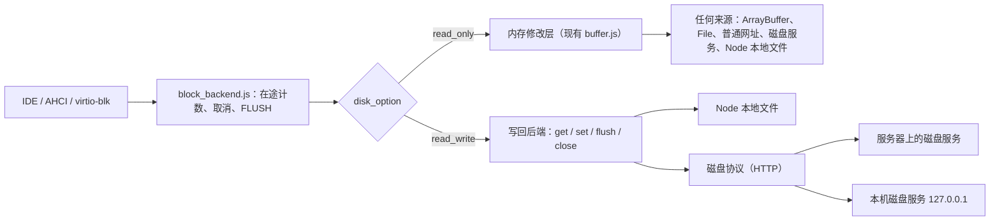

# 磁盘持久化计划：`disk_option`

状态：D0–D3 已实现（2026-10-17，`disk-formats` 分支）。未做：D2 中同步 XHR 的测量与 Chrome 本地网络访问
授权的人工验证，D4（需要测量，并由负责人决定），见[附录](#附录实施记录)末节。
本文是 2026 年 10 月 17 日对“`disk_option` 写回源盘”方案的评审修订版，依据 `arm64` 分支
a6674aa4 的代码。

`disk_option` 决定客户机写入是否写回源镜像：`read_only` 时修改留在内存，`read_write`
时修改持续写回绑定的源镜像。本地和服务器使用同一套语义；配置了 `read_write` 而来源
无法写回时启动报错，绝不悄悄退回内存模式。这些定义保持不变，本文补齐原方案缺少的
写缓存语义、快照规则、错误策略、一致读取与写者隔离，并把后端和实施步骤具体化。

配置上用户只需要认识两个字段：已有的 `url`，和每块盘新加的 `disk_option`。

## 评审结论

原方案的方向、`read_only` 为默认和“不支持就报错”的原则保留。需要修改或补充的是：

1. **命名与已有字段冲突。** 软驱控制器的 `read_only`（[`src/floppy.js:191`](../src/floppy.js)，
   在 952 行拒绝写入）和 `virtio_disks[].readonly`（[`src/virtio_blk.js:65`](../src/virtio_blk.js)，
   报告 `VIRTIO_BLK_F_RO`）都表示客户机不能写，与 `disk_option: "read_only"`（客户机可写、
   源不变）相反。本文保留已定的名字，但文档与类型声明称其为“源镜像策略”，并把两者组合
   的矛盾配置列为启动错误。见[语义](#语义)。
2. **“提交成功”没有定义。** 原方案没有区分“已到达后端”和“已落到稳定存储”。本文定义
   “完成”与“持久”两级，并把关闭标签页的保证落在“完成”上。见
   [写入完成、FLUSH 与写缓存](#写入完成flush-与写缓存)。
3. **现代客户机在 IDE/AHCI 盘上不会发 FLUSH。** IDENTIFY 第 82、85 字未报告写缓存
   （[`src/ide.js:2685`](../src/ide.js) 的 `feat_82` 只有第 14 位），SET FEATURES 什么都接受
   （1508 行），NCQ 的 FUA 位被忽略。原方案的“flush 等待此前所有写入”在这些盘上几乎
   不会被触发；DOS、Windows 9x 等旧系统本来就不发 FLUSH。需要按模式报告写缓存，并由
   后端自行定时 flush。
4. **快照完全没有覆盖。** 现在 IDE 把 buffer 整个放进状态（[`src/ide.js:2937`](../src/ide.js)）：
   同步 buffer 保存整盘，异步 buffer 保存写过的块（[`src/buffer.js:405`](../src/buffer.js)）；
   站点的 Windows 98 状态就带着 C 盘的修改层。`read_write` 下内存状态只与源镜像的某一个
   版本匹配，必须定义保存与恢复规则。见[快照](#快照save_state-与-initial_state)。
5. **只读读者也会读到混合数据。** 一个 `read_only` 会话读取的源若被另一个 `read_write`
   会话修改，或网站更新了镜像，读到的是不同时刻的扇区。需要固定读取版本。见
   [单写者与一致读取](#单写者与一致读取)。
6. **单写者和重试需要具体机制。** 块写入本身是幂等的，真正的危险是旧会话迟到的写入落在
   新会话之后。用租约加递增的 epoch 隔离旧写者，而不是只靠请求去重。
7. **错误没有通道。** `block_write` 的回调没有错误参数（[`src/block_backend.js:79`](../src/block_backend.js)），
   设备层虽有 ATA ERR、AHCI TFES、`VIRTIO_BLK_S_IOERR` 编码，后端失败却无法上报。原方案
   的“失败必须明确上报”要落到一个策略：默认暂停虚拟机并通知宿主，可选报告给客户机。
   见[错误处理](#错误处理)。
8. **ArrayBuffer 来源与表格不符。** `SyncBuffer` 直接写入调用方传入的 ArrayBuffer
   （[`src/buffer.js:78`](../src/buffer.js)，858 行不复制），所以“原镜像不变”对它现在并不成立。
   本文把 ArrayBuffer 定义为没有持久来源的内存镜像。
9. **浏览器不能原地改写用户电脑上的文件。** 用户选取的文件只能经 `createWritable` 在关闭时
   整体替换，同步原地读写只对浏览器私有存储（OPFS）开放。所以浏览器里写回本机镜像经
   本机磁盘服务实现；Node 可以直接写文件，作为参考实现和测试载体。服务器和本机磁盘服务
   用同一个协议、同一份参考实现。见[后端](#后端)。
10. **与格式计划的重叠。** [格式计划](disk-image-formats-plan.md) 拟议的 `overlay: "memory"`
    与本文是同一维度，统一为 `disk_option`；它 P2 中“修改层持久化”的做法不能作为
    `read_write` 的实现。`read_write` 首版只接受 RAW。
11. **不设顶层默认值。** 原方案允许在 V86 选项顶层给一个默认值，由每盘覆盖。顶层写
    `read_only` 与省略相同；写 `read_write` 会让每块没有可写来源的盘启动报错。它还要求定义
    覆盖顺序、对软盘和热插入的盘是否生效，并多一个跨 Worker 转发的字段。写回会改动用户的
    镜像，应在每块盘上显式写出。因此只按盘配置，省略即 `read_only`。

## 语义

### 三个独立的维度

| 维度 | 选项 | 本计划 |
| --- | --- | --- |
| 客户机能否写盘 | 软驱 `read_only`（目前未经 V86 选项暴露）、`virtio_disks[].readonly` | 不变 |
| 客户机的修改写到哪里 | `disk_option` | 本文 |
| 源镜像的格式 | `format` | [格式计划](disk-image-formats-plan.md) |

### 取值

| 取值 | 客户机能否写盘 | 写入完成时数据在哪里 | 关闭标签页或浏览器崩溃后 | 宿主或服务器掉电后 |
| --- | --- | --- | --- | --- |
| `read_only`（默认） | 可以 | v86 的内存修改层 | 修改丢失，源镜像不变 | 同左 |
| `read_write` | 可以 | 源镜像所在的后端，已被后端确认 | 已完成的写入保留；未完成的可能落盘，也可能没有 | 只保证最后一次 flush 完成前已完成的写入 |

- `read_only` 与当前 v86 的行为一致，包括写入块的 16 MiB 分块和快照格式。
- ArrayBuffer 来源是内存镜像，没有可写回的持久来源：`read_only` 保持现状，客户机写入
  直接改动这块内存（需要保留原数据的调用方自行传入副本），`read_write` 报错。
- 未完成的写入指客户机尚未收到完成的写入，等同于真实硬盘掉电时队列中的命令。

### 适用范围

- 适用：`hda`、`hdb`、`attach_sata_drive` 接入的硬盘、`virtio_disks[]`。`disk_option` 写在各自的
  盘描述里，省略时为 `read_only`；没有顶层默认值。
- 后续（D3）：`fda`、`fdb`，同样逐盘设置。
- 不适用：`bios`、`vga_bios`、`cdrom`、`initial_state`、`multiboot`、`bzimage`、`initrd`、
  `kernel`、`dtb`。在这些项上设置 `disk_option` 报错，而不是忽略。

### 配置

镜像仍然用 `url` 指定，和现在一样；每块盘多一个可选的 `disk_option`。能不能
`read_write`，取决于 `url` 指向的镜像能不能被改写：

- **普通网址**（静态托管、CDN 等）：只能 `read_only`。静态服务器没有可靠的方法改写文件的
  某一段，`read_write` 启动报错。
- **支持写盘的磁盘服务**：服务器上的，或运行在用户自己电脑上的本机磁盘服务
  （`127.0.0.1`），两者实现同一个[磁盘协议](#磁盘协议服务器与本机磁盘服务)。可以 `read_write`。
  磁盘服务的网址同时也是普通的可读网址，`read_only` 或旧版 v86 照常按 Range 读取。
- **Node 中的本地路径**：Node 中 `url` 本来就是本地文件路径（[`src/lib.js`](../src/lib.js) 用
  `fs` 读取），可以 `read_write`，直接写回这个文件。

```js
// 以下 hda 任选其一

// 网站上的镜像：和现在一样，修改留在内存
hda: { url: "images/win98.img" }

// 支持写盘的服务器：修改写回服务器上的镜像
hda: { url: "https://disks.example.org/win98.img", disk_option: "read_write" }

// 本机磁盘服务：修改写回自己电脑上的镜像文件
hda: { url: "http://127.0.0.1:8471/win98.img", disk_option: "read_write" }

// Node：url 是本地路径，修改直接写回这个文件
hda: { url: "/images/win98.img", disk_option: "read_write" }
```

v86 只在 `read_write` 时向网址发出“打开写会话”请求，只有带协议响应头的成功响应才算支持
写盘；`read_only` 不发这个请求，现有配置的行为和请求都不变。普通网址配了 `read_write`
时，错误信息说明原因和办法，例如：“hda 的网址只能读取，不能写回。要保存修改，请使用支持
写盘的磁盘服务，或去掉 `disk_option`，让修改只留在内存。”

可选的 `token` 用于需要鉴权的磁盘服务，放进 `Authorization` 请求头，不进网址；同站的磁盘
服务用 cookie 即可，不需要它。

| 来源 | `read_only` | `read_write` |
| --- | --- | --- |
| `buffer`：ArrayBuffer | 可以（直接改这块内存） | 报错 |
| `buffer`：File（`<input type=file>`） | 可以 | 报错：File 不能写回原文件 |
| `url`（浏览器）：普通网址，含 `use_parts`、`fixed_chunk_size`、`.zst` | 可以 | 报错：只能读取 |
| `url`（浏览器）：磁盘服务，服务器或 `127.0.0.1` | 可以 | 可以 |
| `url`（Node）：本地文件路径 | 可以 | 可以，忽略 `async`，按需读写这个文件而不整份读入内存 |
| 自带 `get/set/load` 的对象 | 现状 | 实现[后端契约](#后端契约)后可以，不能跨入 CPU Worker |

### 启动校验

以下情况在启动（或 `attach_sata_drive`、插入软盘）时直接报错，错误信息指明盘符和原因：

- `disk_option` 不是 `read_only` 或 `read_write`，或写在 V86 选项顶层，或出现在不适用的项上。
- `read_write` 的来源不在上表的可写列，包括打开写会话被拒绝、跨站时 CORS 预检不通过。
- `read_write` 与客户机写保护同时设置（`readonly: true` 或软驱写保护）：没有可写回的内容。
- `read_write` 的 `format` 不是 RAW（原格式写入属于格式计划 P5）。
- 同一源镜像在一份配置里被两个盘以 `read_write` 绑定，或一个 `read_write`、一个 `read_only`。
- 拿不到写者租约（另有写者），或报告的容量不是扇区的整数倍。

## 写入完成、FLUSH 与写缓存

### 两级保证

| 级别 | 含义 | `read_write` 后端的实现 |
| --- | --- | --- |
| 完成 | 后端已接受写入；此后任何经该后端的读取都返回新数据；关闭标签页、浏览器崩溃不丢 | Node：`fs.writeSync` 返回；磁盘服务：已写入服务器上的源文件 |
| 持久 | 宿主或服务器掉电也不丢 | Node：`fs.fdatasyncSync` 返回；磁盘服务：服务器端 `fdatasync` 已返回 |

- 设备只在“完成”后向客户机报告写入完成。首版不设本地日志：写进浏览器内的日志再异步
  上传，会让其他读者看到旧数据，也会让关闭标签页的保证依赖同一浏览器下次打开。
- 服务器端可以用日志做自身的崩溃恢复，但写入只有在后端保证任何读者都能读到时才算完成；
  只保存一份独立修改层不能算作写回源镜像。
- FLUSH 只需等待在它之前已发出的写入，然后让后端 flush。现在的
  [`block_when_writes_done`](../src/block_backend.js) 等到在途写入归零，持续写入时可能一直
  等不到；改为按序号等待更早的写入。

### 向客户机报告写缓存

“完成”相当于数据进入了宿主的页缓存，也就是一块易失的写缓存。按实情报告它，客户机才会
在需要时发 FLUSH：

- **IDE 与 AHCI（共用 [`IDEInterface`](../src/ide.js)）。** `read_write` 盘在 IDENTIFY 第 82 字
  第 5 位报告支持写缓存，第 85 字第 5 位报告已启用；SET FEATURES 02h/82h 开关写缓存，并在
  快照中保存这个状态。客户机关闭写缓存后，每个写入在持久之后才完成。AHCI NCQ 写入
  （WRITE FPDMA QUEUED）带 FUA 位时，该写入持久之后才完成。首版不报告 WRITE DMA FUA EXT
  （第 84 字第 6 位）。`read_only` 盘的 IDENTIFY 不变，已有安装和快照看到的硬件不变。
  Linux 的 libata 把未报告的写缓存经 SCSI 缓存模式页报成 WCE=0，块层随即丢弃 flush，所以
  现在 Linux 在这些盘上不发 FLUSH；Windows 同样按缓存模式页决定，实施时用 trace 确认。
- **virtio-blk。** 已协商 `VIRTIO_BLK_F_FLUSH`（[`src/virtio_blk.js:64`](../src/virtio_blk.js)），
  Linux 驱动按回写缓存处理并发送 flush，不需要改动。
- **后端定时 flush。** 旧系统可能从不发 FLUSH。`read_write` 后端在最后一次未持久的写入之后
  的一个时限内自行 flush（空闲 1 秒，持续写入时最长 5 秒），并在 `stop()`、`destroy()`、
  `detach_sata_drive`、弹出软盘和页面 `pagehide` 时 flush。服务器在租约到期或连接断开时也自行
  flush。

## 快照：`save_state` 与 `initial_state`

`read_write` 盘的内容在源镜像里，快照不再携带磁盘数据，只携带对源镜像的引用：

- 每个后端提供稳定身份和 generation。磁盘服务的身份是网址加服务器生成的 UUID，generation
  就是它返回的 ETag；Node 的身份是真实路径加设备号与 inode，generation 可用
  (inode, 大小, 纳秒级 mtime)。任何写入之后 generation 必然变化，包括 v86 之外的写入：磁盘
  服务用计数器，并在发现源文件被外部改动时递增。
- 保存：先 flush，再取 generation 并记下；之后的第一次写入先使 generation 递增，再写数据。
  状态中记录身份、generation、容量和写缓存开关，不含数据。保存与恢复的流式版本
  （`save_state_stream`、`restore_state_stream`）同样处理。
- 恢复按下表判断，拒绝时报出盘符、身份和两个 generation：

| 保存时 | 恢复时的配置 | 结果 |
| --- | --- | --- |
| `read_only`，状态中带修改层 | `read_only` | 现状：恢复修改层 |
| `read_only`，状态中带修改层 | `read_write` | 拒绝：修改层不会被写进源镜像。需要的话另设显式的“提交修改层”操作，不在本计划 |
| `read_write` | `read_write`，同一身份，generation 相同 | 恢复 |
| `read_write` | `read_only`，同一身份，generation 相同 | 恢复，修改层为空 |
| `read_write` | 身份不同或 generation 不同 | 拒绝 |

- 机器在保存后继续运行并写盘，generation 就变了，那份快照随之作废。因此 `read_write` 的
  快照实际只用于“保存后关机”（休眠）；页面对 `read_write` 盘提供“保存并关机”，而不是
  可反复回滚的快照。
- 现在 IDE 恢复时不检查镜像身份（[`src/ide.js:2977`](../src/ide.js)），virtio-blk 只对内存中的镜像
  检查 SHA-256（[`src/virtio_blk.js:179`](../src/virtio_blk.js)）。本计划只对 `read_write` 强制身份
  检查；`read_only` 的身份检查属于格式计划 P1，不改变站点现有状态的恢复行为。
- 有写入因故障挂起（见[错误处理](#错误处理)）时拒绝保存，避免状态等待一个不会结束的 I/O。

## 单写者与一致读取

- **写者租约。** 打开写会话时磁盘服务发放租约和递增的 epoch，客户端定期续租。每个写入
  携带 epoch 和会话内序号；服务器拒绝旧 epoch 的写入。被接管的旧标签页，其迟到的写入或
  重试因此不能落在新会话之后。租约丢失不可重试，按错误处理暂停或报告。
- **重试。** 块写入是幂等的，重试沿用原 epoch 和序号，服务器对已应用的序号直接返回成功。
  客户端不同时发出两个范围重叠的写入：后来的写入等待先前的完成，重试就不会越过较新的
  写入。超过重试次数或超时（建议单请求 30 秒）即视为失败。
- **Node。** 首版不做跨进程锁，文档说明；本机磁盘服务用与服务器相同的租约。
- **一致读取。** `read_only` 记下第一次响应的 ETag（读不到时用 Last-Modified），之后每个
  Range 响应都核对；不一致说明源在会话中被改动（另一会话写入，或网站更新了镜像），该盘
  按读取失败处理，绝不拼出不同时刻的数据。核对响应而不是在请求里加 `If-Match`：
  [`load_file`](../src/lib.js) 已带自定义请求头 `X-Accept-Encoding`，跨站时本来就要 CORS 预检，
  不少静态托管只放行列出的请求头，加一个新请求头可能让现在能用的读取失败。跨站时 ETag
  须经 `Access-Control-Expose-Headers` 公开才读得到，Last-Modified 不需要；两者都读不到时
  与现在一样不核对。
- **HTTP 缓存。** `read_write` 会话的读取带会话标识，磁盘服务对可写盘的数据响应一律
  `Cache-Control: no-store`，因为 `load_file` 用的是会经过浏览器 HTTP 缓存的 XHR。v86 之外的
  持久块缓存（例如站点的）必须以（身份, generation）为键。

## 错误处理

- 后端回调改为错误优先：`set(start, data, fn(error))`、`flush(fn(error))`、读取同理。旧的
  buffer 从不传错误，保持兼容。读取错误的通道与格式计划 P0 的错误契约是同一件事，一次做完。
- 设备编码：IDE 置 ERR 并在错误寄存器置 ABRT（与 QEMU 的 `ide_rw_error` 相同）；AHCI 置
  TFES，NCQ 命令经现有的 `ncq_failed`（[`src/ahci.js:1158`](../src/ahci.js)）进入错误日志；
  virtio-blk 返回 `VIRTIO_BLK_S_IOERR`。
- 逐盘选项 `disk_error: "stop" | "report"`，默认 `stop`（已决定）。网络抖动在浏览器里很常见，直接把
  I/O 错误交给客户机，Linux 可能把文件系统改为只读，Windows 在分页 I/O 失败时可能蓝屏：
  - `stop`：失败的请求保持未完成，虚拟机经 `stop()` 的路径暂停，触发 `disk-error` 事件
    （盘符、操作、偏移、长度、原因、能否重试）；`run()` 按原顺序重试挂起的请求；`destroy()`
    放弃它们，等同于掉电。不可重试的错误（租约丢失、服务器空间不足）只能 `report` 或
    `destroy()`。
  - `report`：立即以上述设备编码报告给客户机，同样触发事件。

## 后端

### 后端契约

写回后端放进设备现在使用的 buffer 位置，[`block_backend.js`](../src/block_backend.js) 已在 111
行调用 buffer 自带的 `flush`，设备层只需加入错误和写缓存的改动。

| 操作 | 要求 |
| --- | --- |
| `load()`、`byteLength` | 打开来源，取得容量、身份、generation，必要时取得写者租约 |
| `get(offset, length, fn(data) / fn(undefined, error), { signal })` | 读取；可同步回调（错误后置，见附录 D0 决定 1） |
| `set(offset, data, fn(error))` | 写入；`fn` 表示已完成 |
| `flush(fn(error))` | 此前已完成的写入全部持久 |
| `mark()`、`generation()` | 快照用，见上文 |
| `get_state()`、`set_state()` | 返回、核对引用记录（身份、generation、容量），不含数据 |
| `close(fn(error))` | flush 并释放写者锁；`destroy()`、拔出与弹出时调用 |

- 偏移和长度按设备扇区对齐（硬盘 512 字节），不是内存修改层的 256 字节块。
- **最好能同步完成。** Promise 的回调要等当前 CPU 时间片结束才运行；SeaBIOS 的 AHCI 驱动
  逐条轮询，Windows 8.1 在 Q35 上的 BIOS 磁盘阶段异步读取时约 180 秒，在 CPU Worker 中改用
  `FileReaderSync` 同步读取后约 20 秒（[sata.md](sata.md#disk-backends)）。Node 后端同步完成。
  浏览器里的写回都经磁盘服务，是网络请求：CPU Worker 允许同步 XHR，对 `127.0.0.1` 的本机
  磁盘服务可用它同步完成，代价是请求期间 CPU 线程阻塞，D2 中测量后决定；远程服务器只用
  异步请求，在 Q35 上 BIOS 阶段会像现在的网址磁盘一样慢。
- CPU Worker 只能接收数据描述（[`encode_worker_file`](../src/browser/cpu_worker.js) 按固定字段
  转发并拒绝带方法的对象）：新增 `disk_option`、`disk_error`、`token` 三个字段，后端在 Worker
  内构建。

### Node 本地文件（参考实现）

盘描述里的 `url` 就是这个文件。用同步接口 `fs.openSync(url, "r+")`、带位置参数的
`fs.readSync`/`fs.writeSync` 和 `fs.fdatasyncSync`，同步完成；现有的 Node 读取路径用的是
`fs` 的异步接口，写回后端不沿用它。它最容易测试，用来验证设备层、写缓存、快照和错误策略，
再接入磁盘服务。

### 磁盘协议：服务器与本机磁盘服务

服务器和本机磁盘服务实现同一个 HTTP 协议，仓库在 `tools/` 下提供一份无依赖的 Node 参考
实现，两种部署共用。所有操作都发往镜像自己的网址：读取就是普通的 Range GET，所以磁盘服务
的网址也能当普通网址用；其余操作用 POST，以请求头区分，具体名字在实施时确定。

| 操作 | 语义 |
| --- | --- |
| 读取 | Range GET，响应带 ETag（即 generation）；写会话的读取带会话标识；校验状态码、`Content-Range` 和实际长度 |
| 打开写会话 | 返回容量、扇区大小、身份、generation、会话、epoch、租约时长，并带协议响应头；已有有效写者时拒绝 |
| 续租、关闭会话 | 关闭时先 flush 再释放 |
| 写入 | 携带偏移、会话、epoch、序号；写入服务器上的源文件后才返回成功 |
| flush | 服务器端 `fdatasync` 之后返回 |

- 写入不用带 `Content-Range` 的 PUT：各服务器对部分 PUT 的支持不一致，不支持的服务器可能
  把请求体当作整份替换（RFC 9110 §14.5），一次 512 字节的写入就会抹掉整个镜像。
- 自定义请求头需要 CORS 预检；ETag 等响应头需列入 `Access-Control-Expose-Headers`。
- 服务器存的可以不是 RAW（例如由 qemu-nbd 一类工具转换），那是服务器自己的事；对 v86 协议
  只有虚拟扇区。
- 本机磁盘服务即参考实现监听 `127.0.0.1`，提供启动时指定目录下的镜像，用来写回用户自己的
  镜像文件。它默认只接受启动时指定的来源页面（核对 `Origin`），需要更严时再加 `token`。
  公网 HTTPS 页面访问回环地址时，Chrome 142 起会弹出“本地网络访问”授权；从 localhost
  提供页面则不会。其他浏览器的行为在 D2 验收中实测。
- 远程 `read_write` 的每个写入至少等一个往返：IDE 一次一个命令，AHCI NCQ 最多 32 个，
  virtio 按队列深度。合并相邻写入属于后续优化；性能指标在取得基线后再定。
- NBD over WebSocket（qemu-nbd、nbdkit 加 websockify）可作为后续的另一种传输，它没有租约和
  鉴权，需要网关补上；首版用 HTTP，读取与现有 Range 路径一致。

### 为什么不直接写用户选取的文件（D4，视测量决定）

`showOpenFilePicker` 只有 Chromium 提供。`createWritable` 把写入放进临时文件，关闭时才替换
原文件；`keepExistingData` 先把整个原文件复制过去；Chromium 对用户文件没有原地写入模式，
同步句柄只对 OPFS 有效（[File System 规范][fs-spec]）。要满足“完成即在源镜像”，每个写入都得
关闭一次，即整文件复制一次，只可能适用于软盘大小的镜像。把写入攒到 FLUSH 再提交不满足
`read_write` 的定义，不能以这个名字提供。将来如果为小镜像提供，文件句柄与 File 一样放在
`buffer` 里，不新增字段；大镜像用本机磁盘服务。

## 缓存

- `read_only`：内存修改层不变，写过的块不会被淘汰。
- `read_write`：没有修改层，读缓存有上限并可淘汰。写入在完成回调之前更新缓存；每个块记录
  最近一次写入的序号，读取结果只在发起读取之后没有对该块的写入时才放进缓存，较早开始的读取
  因此不能覆盖较新的写入。这取代 [`handle_read`](../src/buffer.js) 在修改层模式下用写过的块
  覆盖读取结果的做法。
- **Get hard disk image** 对 `read_write` 盘先 flush，再从源导出（磁盘服务的网址、Node 的本地
  文件），不再拼接修改层。

## 架构



策略在磁盘初始化时解析，入口是 [`add_file`](../src/browser/starter.js)（764 行）、
`attach_sata_drive`（1758 行）和 `virtio_disks`（833 行）；`read_only` 走现有 `buffer_from_object`，
`read_write` 构建写回后端。具体模块文件名在实施时确定。

## 实施阶段

| 阶段 | 工作内容 | 验收 |
| --- | --- | --- |
| D0 | 选项解析与启动校验，经 Worker 传递；错误优先回调贯通 `block_backend`、IDE、AHCI、virtio-blk；`disk_error` 策略与 `disk-error` 事件；FLUSH 按序号等待；`read_only` 网址的 ETag/Last-Modified 核对 | `read_only` 读到的数据和发出的请求不变；每条校验规则有测试；注入的错误在 `stop` 下暂停并可恢复，在 `report` 下客户机看到 I/O 错误 |
| D1 | Node 本地文件（`url`）的写回后端；写缓存报告、SET FEATURES 02h/82h、NCQ FUA、定时 flush；身份、generation 与快照规则；`destroy` 与拔出时 `close` | Linux 客户机写入、`sync` 后销毁实例，直接读源文件得到数据；快照矩阵逐项通过 |
| D2 | 磁盘协议、`tools/` 参考服务与浏览器端后端；租约、epoch、`no-store`；本机磁盘服务的来源核对与部署说明；测量对 `127.0.0.1` 用同步 XHR 的效果 | 无头 Chrome 中写入后关闭页面，直接读服务端的源文件得到数据；普通网址配 `read_write` 给出说明性错误；旧 epoch 被拒；Chrome 本地网络访问授权流程走通 |
| D3 | 软盘的 `disk_option`；页面入口（`read_write` 盘的“保存并关机”、错误提示） | 软盘写回磁盘服务与 Node 文件；页面流程手动走通 |
| D4 | 测量 `createWritable` 的提交成本，决定是否为小镜像提供文件句柄来源 | 有测量数据再定，不预先承诺 |

D0 与格式计划 P0 的错误契约合并实施。D1 先于浏览器端，是因为设备层的改动（写缓存、错误、
快照）在 Node 中最容易验证。

## 验收矩阵

| 范围 | 必测内容 |
| --- | --- |
| 源镜像不变 | `read_only` 下 Node 本地文件与磁盘服务：客户机写入、复位、保存恢复前后，源的 SHA-256 不变 |
| 写回 | Linux 客户机写文件并 `sync`，销毁实例或关闭页面，直接打开源镜像核对；不发 FLUSH 的客户机（Windows 98）靠定时 flush 写回 |
| 完成即保留 | Linux `dd oflag=direct` 写入后不 `sync` 直接关闭页面，数据在源中 |
| 持久 | 带记录的后端核对：每个 FLUSH 完成前，此前已完成的写入都已 flush；模拟掉电（丢弃未 flush 的写入）后客户机文件系统检查通过 |
| 写缓存 | Linux 对 `read_write` 的 IDE/AHCI 盘报告写缓存已启用、对 `read_only` 盘不变；`hdparm -W0` 后每个写入持久后才完成；NCQ FUA |
| 快照 | 快照表格的每一行；保存后继续写入再恢复被拒；带修改层的站点状态加 `read_write` 被拒 |
| 写者 | 第二个写者被拒；租约接管后旧 epoch 的写入被拒；同一配置中重复绑定被拒 |
| 一致读取 | 只读会话期间源被改动，读取报错而不混读；跨站静态托管只读照常工作；可写盘响应不被 HTTP 缓存 |
| 错误 | 超时、5xx、断网、服务器空间不足、租约丢失在两种策略下的表现；挂起时拒绝保存状态；普通网址与跨站 CORS 失败时的错误信息 |
| 入口 | Node、浏览器 CPU Worker、`cpu_worker=0`；IDE、AHCI（含 NCQ）、virtio-blk；SATA 热插拔拔出时释放租约 |
| 回归 | 现有测试全部通过 |

复用 [`tests/devices/ahci_lifecycle.mjs`](../tests/devices/ahci_lifecycle.mjs)（异步后端、FLUSH
顺序、带在途 I/O 拔盘）、[`tests/devices/device_io_reset.mjs`](../tests/devices/device_io_reset.mjs)、
[`tests/devices/disk_write_cache.js`](../tests/devices/disk_write_cache.js)、
[`tests/devices/q35_guest.js`](../tests/devices/q35_guest.js)、[`tests/api/state.js`](../tests/api/state.js)
和 [`tests/smp/disk_fixture.mjs`](../tests/smp/disk_fixture.mjs)，新增后端与协议的独立测试。
重的浏览器会话用无头 Chrome，不在 Claude 应用的内置浏览器里跑。

## 后续单独考虑：在浏览器里保留修改

静态托管的网站可能希望访问者的修改在他自己的浏览器里跨会话保留，例如把镜像整份复制进
浏览器私有存储（OPFS），之后在副本上读写。这样网站上的镜像始终不变，相当于“源镜像只读，
修改另存一份并长期保留”，不是写回源盘，所以不属于 `read_write`，也不在本计划内。站点目前
靠保存状态（状态中带修改层）保留进度。如果以后要做，作为另一个有独立名字的功能设计，并与
本文的快照规则衔接；格式计划 P2 原先的 OPFS 修改层设想也归到这里。

## 已决定

以下七项于 2026 年 10 月 17 日由项目负责人确定：

1. `disk_error` 默认 `stop`，`report` 为可选项。
2. `read_write` 的 IDE/AHCI 盘报告易失写缓存，客户机可用 SET FEATURES 关闭；不采用写穿
   （每个写入都持久后才完成，远程时会非常慢）。
3. 定时 flush：最后一次未持久的写入之后空闲 1 秒即 flush，持续写入时最长 5 秒 flush 一次。
4. 取值保留 `read_only`/`read_write`；与客户机写保护的区别靠文档、类型声明和启动校验说明。
5. 镜像只用 `url` 指定，不新增来源字段：`url` 指向磁盘服务（服务器或 `127.0.0.1`）或 Node 本地
   文件时可以 `read_write`，普通网址只能 `read_only`。`token` 是磁盘服务鉴权的可选字段。
6. `disk_option` 只按盘配置，省略即 `read_only`，不设顶层默认值（理由见评审结论第 11 条）。
7. 在浏览器里保留修改（OPFS 副本）不属于 `read_write`，记为后续单独考虑的功能。
   （2026-10-18 注，负责人确认）这里指以网站或本地镜像为源、修改另存一层的做法。
   [虚拟机管理器计划](vm-manager-plan.md#浏览器磁盘opfs)的浏览器磁盘不是修改层，而是 OPFS 中
   一份完整的镜像（新建，或整份复制导入），网址为 `opfs:…`；它是自己的源，`read_only` 与
   `read_write` 照常适用于它。

## 参考资料

- [File System 规范][fs-spec]：`createSyncAccessHandle` 仅限 OPFS，`createWritable` 的临时文件与
  `keepExistingData`
- [web.dev：打开文件][webdev-open]：`showOpenFilePicker` 的浏览器支持
- [RFC 9110 §14.5 Partial PUT][rfc9110-put]
- [Chrome 本地网络访问][chrome-lna]

[fs-spec]: https://fs.spec.whatwg.org/
[webdev-open]: https://web.dev/articles/files/open-one-or-multiple-files
[rfc9110-put]: https://www.rfc-editor.org/rfc/rfc9110#section-14.5
[chrome-lna]: https://developer.chrome.com/blog/local-network-access

## 附录：实施记录

实施在 `disk-formats` 分支：先合并 `arm64`（a22bd3a5，合并提交 9f2c96e8，见[格式计划](disk-image-formats-plan.md)
附录末节），格式计划 P0 的错误通道因此已在 `block_backend.js` 中、IDE/AHCI/virtio-blk 共用；本文
原样提交于 ac43a1e2。测试入口：`make disk-persistence-tests`（Node），`make disk-persistence-browser-tests`
（无头 Chrome，页面与 CPU Worker）；设备与 API 测试也加入了 `devices-test`、`api-tests` 与
`a64-virt-device-tests`。同机有长时间门禁运行，只做定向测试，未做计时测量。

### D0 选项、错误策略、FLUSH 顺序、一致读取（81b63b0d）

**实现。**

- 选项：新模块 [`src/disk_options.js`](../src/disk_options.js)。`check_disk_options` 在 V86 构造函数中、
  加载任何文件之前同步检查（CPU Worker 中再查一次），`attach_sata_drive` 在挂接前检查（并与机器已有
  的盘比较）。规则：`disk_option`、`disk_error`、`token` 写在 V86 选项顶层报错；取值不对报错；
  `disk_option` 只用于硬盘（`hda`、`hdb`、SATA 盘、`virtio_disks`），`disk_error` 用于硬盘与光驱，
  `token` 只能是字符串、只用于盘；`bios`、`initial_state`、`bzimage` 等一律报错；软盘上
  `read_only` 等同省略，`read_write` 与 `disk_error` 报“D3”；`read_write` 与 `readonly: true`、与非
  RAW 的 `format` 同时出现报错；同一来源（同一网址、同一 buffer 对象）被两块盘绑定且其一为
  `read_write` 报错；`read_write` 的来源在 D0 一律报错，错误信息按来源说明原因与办法
  （ArrayBuffer：内存镜像，没有持久来源；File：浏览器不能原地写回用户选取的文件，用本机磁盘服务；
  分片与 `.zst`：只能读；自带对象：需实现后端契约；Node 本地文件：D1；网址：D2）。格式计划的
  `check_image_options` 改为调用同一检查。`encode_worker_file` 转发 `disk_error`、`token`。检查通过的
  策略放在盘的 buffer 上（`disk_name`、`disk_error`），设备层从那里读取。
- 错误策略（[`src/block_backend.js`](../src/block_backend.js)）：读写与 flush 失败时先触发 `disk-error`
  事件（`disk`、`operation`、`offset`、`length`、`reason`、`retryable`、`policy`），再按策略：
  `report` 立即交给设备的错误编码；`stop`（默认）把请求挂在 CPU 上（`cpu.disk_holds`），经
  `v86.stop()` 暂停机器。`v86.run()` 按原顺序重试挂起的请求，不可重试的则在此时报告给客户机；
  `destroy()` 与恢复快照（`CPU.set_state`、`A64CPU.set_state`，校验通过之后）丢弃它们，等同掉电；
  设备复位丢弃挂起的读与 flush（挂起的写仍在 `run()` 时落盘，完成不再通知，与复位时在途写入的规则
  一致）；SATA 拔盘丢弃该盘挂起的请求。有挂起请求时 `save_state` 与流式保存拒绝并说明原因。
  是否可重试：错误自带 `retryable` 时按它，格式层的错误按 `kind`（只有 `io` 可重试），其他错误可重试；
  修改层预算不足、来源在读取中改变均不可重试。
- FLUSH 按序号等待：每个写入取递增序号，FLUSH 记下发出时的最大序号，等序号不大于它的写入都结束
  （完成或报告失败）后再调用 buffer 的 `flush`；之后发出的写入不再拖住它。挂起（`stop`）的写入
  仍算未结束，排在它后面的 FLUSH 一直等到它被重试成功。
- 一致读取（[`src/buffer.js`](../src/buffer.js) 的 `check_response_version`）：`AsyncXHRBuffer` 与
  `AsyncXHRPartfileBuffer`（每个分片文件各记各的）记下第一个带 ETag（没有时用 Last-Modified）的
  响应，之后每个 Range 响应核对；不一致时该次读取以 `changed`（不可重试）失败。请求不变，不加
  `If-Match`。同时补上原来没有通道的读取失败：4xx 状态（原来请求永远不结束）、对 Range 请求回
  200（`load_file` 原来中止后不再回调，现在调用 `options.error`）、响应短于请求、`File` 读取失败
  （`FileReader.onerror`、`FileReaderSync` 抛出）、Node 中本地文件分段读取失败。`get_and_cache` 转发
  错误。
- 文档与类型：`v86.d.ts` 增加 `disk_error`、`token`、`disk-error` 事件，`disk_option` 的说明改为“源镜像
  策略”，与 `readonly` 区分。

**决定与偏差。**

1. **读取回调保持错误后置**：成功 `fn(data)`，失败 `fn(undefined, error)`；写入与 flush 为 `fn(error)`。
   这是格式计划 P0 已采用、并在合并时进入 `block_backend.js` 的约定（理由见格式计划附录 P0 偏差 1：
   旧 buffer 以 `fn(data)` 回调，错误前置会让未改动的消费者把 Error 当数据静默写入）。后端契约表
   相应改为 `fn(data) / fn(undefined, error)`，全部代码一种约定。
2. **`disk_error` 也用于光驱**：计划的适用范围表是针对 `disk_option` 的；光驱的读取同样经
   `block_backend.js`，网络抖动的理由同样成立，所以接受 `cdrom` 上的 `disk_error`（默认 `stop`）。软盘
   不经 `block_backend.js`（ISA DMA 路径），`disk_error` 留到 D3。
3. **不可重试的错误在 `stop` 下**：计划说这类错误“只能 `report` 或 `destroy()`”。实现为：同样暂停并
   触发事件（`retryable: false`），之后的 `run()` 不重试而是把它报告给客户机。客户机（BIOS、DOS）
   往往自己重试，每次重试又失败并再次暂停：浏览器测试中 MS-DOS 的一次读错误需要 4 次 `run()` 才
   显示“General failure reading drive C”。
4. **默认 `stop` 改变了格式计划已有的错误行为**：损坏簇、修改层预算不足原来立即报告给客户机，现在
   默认暂停机器。格式计划中验证客户机看到 ERR/ABRT、TFES、IOERR 的测试（`ide_disk_image.js`、
   `ahci.js`、`virtio_blk_disk_image.mjs`）改为显式 `disk_error: "report"`。
5. **挂起的请求不计入快照等待的在途 I/O**：否则 `state_transaction` 会等 30 秒后超时；按计划改为
   明确拒绝保存。
6. **浏览器 HTTP 缓存**：对没有 `Cache-Control` 的静态响应，Chrome 会自行加 `If-None-Match`、
   `If-Range` 重新验证；这些不是 v86 加的，旧版同样如此，测试把它们与浏览器的固定请求头一起排除。

**测试结果。**

| 测试 | 结果 |
| --- | --- |
| `tests/api/disk-options.js`（新） | 顶层三个字段、错误取值、`token` 类型、适用范围（光驱、`bios`、`initial_state`、`bzimage`、软盘）、`read_write` 的六类来源（ArrayBuffer、File、分片、QCOW2、`readonly` 的 virtio 盘、无后端契约的自带对象）各报出盘符与原因；重复绑定（含与已挂接的盘）报错、两个 `read_only` 不报错；Worker 描述带 `disk_option`、`disk_error`、`token`；策略到达 IDE 的 buffer（硬盘 `report`、光驱默认 `stop`） |
| `tests/devices/disk_error.mjs`（新） | IDE，客户机（`jmp $` 引导扇区）运行中经端口发命令：`stop` 下读失败→`emulator-stopped`、事件字段完整、命令 BSY、`save_state` 被拒，`run()` 重试后 DRQ 且数据正确；写失败挂起、`run()` 后落盘；不可重试的读由 `run()` 报告为 ERR/ABRT 且未重读；SRST 丢弃挂起的读；恢复快照丢弃挂起的写；`destroy()` 丢弃挂起的读；`report` 下读写立即 ERR/ABRT、机器继续运行。7/7 |
| `tests/devices/ahci.js`（新增一项） | `stop` 下失败的 NCQ 读挂起（SACT 保留该 tag），`run()` 后完成、数据正确；`report` 下失败的 NCQ 写立即 TFES、TFD 0x0441。32/32 |
| `tests/a64/virtio_blk_disk_error.mjs`（新） | 写 A（50 ms）、FLUSH、写 B（400 ms）同批提交：完成顺序 A、FLUSH、B（旧实现为 A、B、FLUSH）；`stop` 下失败的写挂起、其后的 FLUSH 等待，`run()` 后两者依次完成；失败的读挂起后重试；`report` 下读写均 `VIRTIO_BLK_S_IOERR` |
| `tests/persistence/response_version.mjs`（新） | ETag 优先、无 ETag 时用 Last-Modified、没有版本的响应不核对、各文件分开、错误为 `changed` 且不可重试 |
| 浏览器（`tests/persistence/browser_runner.mjs`，页面与 CPU Worker） | MS-DOS 从 HTTP Range 读取的 RAW 盘启动；服务器改变 ETag 后 `copy C:\DOS\*.* NUL`：`disk-error`（`changed`，不可重试）、机器暂停、`save_state` 被拒，`run()` 4 次后客户机显示 “General failure reading drive C”；`disk_error: "report"` 时客户机立即看到错误、机器继续运行；另一来源（CORS，不公开 ETag）照常读取且不核对；两种模式各 1016 个镜像请求，v86 发出的请求头只有 `Range`、`X-Accept-Encoding` |
| 回归 | `make disk-image-tests`（全部格式、设备与客体测试）与 `make disk-image-browser-tests`（页面与 CPU Worker）通过；`ide_disk_image`、`ahci_lifecycle`、`device_io_reset`（x86 与 virt）、`disk_write_cache`（10/10）、`ide_large_disk`、`virtio_blk_disk_image`、`api/state`、`floppy`、`cdrom-insert-eject`、`clean-shutdown`、`destroy-during-init`、`reset`、`arm64-options` 通过；Closure（`libv86.js`、`libv86.mjs`、`cpu-worker.js`、`v86_all.js`）0 错误；eslint 无输出 |

### D1 Node 本地文件的写回后端、写缓存、快照规则（42ddaf44）

**实现。**

- 新模块 [`src/disk_writeback.js`](../src/disk_writeback.js)：
  - `NodeFileDisk`：Node 中 `url` 的本地文件，`fs.openSync(url, "r+")`，带位置参数的 `readSync`/`writeSync`、
    `fdatasyncSync`，同步完成（`async` 忽略，从不整份读入）。打开时检查：不能以写方式打开、大小不是
    512 的整数倍、与描述的 `size` 不符、本进程中已有一块盘在写回同一文件（设备号加 inode，跨机器）均
    报错。写入返回即“完成”；`flush` 为 `fdatasync`；定时 flush：最后一次写入后 1 秒，持续写入时自第一个
    未持久的写入起最多 5 秒（Node 中定时器 `unref`，不阻止进程退出）；`close` 先 flush 再关闭。
  - 身份 = 真实路径、设备号、inode；generation = (inode, 大小, 纳秒级 mtime)，取自 `fstat` 的 bigint 结果。
    快照：`get_state` 先 flush 再记下 generation（`mark`），返回引用 `["v86-writeback", 1, 身份, generation,
    容量]`，不含数据；其后第一次写入在写数据之前用 `futimes` 把 mtime 设为标记时刻加 1 ms（或当前时间，
    取较晚者），写后若时间戳因文件系统时间粒度恰好回到标记值再设一次。
  - `check_disk_state`、`restore_disk_state`：x86 的 `validate_disk_states`、IDE 的 `set_state`、virtio-blk 的
    `check_state`/`set_state` 都经它们，按快照表：写回盘只接受同一身份、同一 generation、同一容量的
    引用；`read_only` 盘接受写回盘的引用的条件是它能给出自己镜像的身份与 generation（Node 中分段读取
    的本地文件，`AsyncXHRBuffer`），此时清空修改层与读缓存；整份读入内存的盘（`url` 不带 `async`）、
    浏览器中的盘无从核对，拒绝（D3 起，分段读取磁盘服务的盘可以凭服务的 ETag 核对）；带修改层的快照
    恢复到写回盘拒绝。
  - `check_loaded_disks`：所有盘加载后按设备号与 inode 再查一次同一文件被两块盘绑定（符号链接、
    相对路径等字符串不同的情况）；Node 中有本地文件的盘时预先加载 `node:fs`，供恢复时同步取引用。
- 选项（[`src/disk_options.js`](../src/disk_options.js)）：Node 中字符串 `url` 可以 `read_write`；自带对象实现
  后端契约（`flush`、`close`、`mark`、`generation`、`get_state`、`set_state`、`check_state`）即可 `read_write`，
  缺哪些方法在错误信息中列出；`read_write` 盘的 buffer 带 `writeback` 标志。
- 设备层：`read_write` 盘（`writeback`）的 IDENTIFY 第 82 字第 5 位报告写缓存、第 85 字第 5 位报告已启用；
  SET FEATURES 02h/82h 开关它（其他盘与其他子命令照旧只接受），开关保存在 IDE 状态第 29 项（旧状态
  缺省为开）；关闭时每个写入在 buffer 的 `flush` 完成之后才完成（`block_write` 的 `durable`）；AHCI NCQ
  写入的 FUA（FIS 设备寄存器第 7 位）同样。`read_only` 盘的 IDENTIFY 不变。
- 生命周期（[`starter.js`](../src/browser/starter.js)）：`stop()` 之后 flush 写回盘（机器已停时也 flush），
  `destroy()` flush 并关闭，`detach_sata_drive` 关闭该盘，`export_disk_image` 先 flush 再从文件读出；启动
  失败时关闭已打开的写回文件。
- `v86.d.ts`：`disk_option` 的说明改为现状（Node 本地文件与带契约的自带对象可写回，磁盘服务为 D2）。

**决定与偏差。**

1. **generation 的递增方式**：Node 的 generation 按计划用 (inode, 大小, mtime)；“第一次写入先使
   generation 递增”通过写前 `futimes` 实现。粗粒度时间戳的文件系统上，写入本身可能把 mtime 设回标记值，
   写后再设一次；两次之间若进程崩溃，generation 可能等于标记值而数据已变，这个窗口无法在不额外写
   元数据的前提下消除，记录在此。
2. **单写者**：按计划首版不做跨进程锁；同一进程内同一文件（设备号加 inode）只允许一块盘写回。
3. **写缓存开关在机器复位后保留**（客户机最后一次 SET FEATURES 的值），SRST 也保留；Linux、Windows
   在复位后会重新设置。保存在快照中。
4. **验收中的客户机工具**：本机的 Linux 镜像（`linux4.iso`，Linux 4.16，busybox 1.28）的 `dd` 没有
   `oflag=direct`，也没有 `e2fsck`；宿主机没有 e2fsprogs，且不能下载。因此：
   - “完成即保留”用块设备的 `sync` 验证：Linux 4.16 对块设备的 `sync` 只写出、不发 FLUSH（测试同时核对
     这一步没有 FLUSH CACHE 命令），命令返回后直接读文件得到数据；浏览器中“关闭页面”属于 D2。
   - “持久”用带记录的后端（实现后端契约的自带对象）验证：客户机的每个 FLUSH 完成时，在它发出之前完成的
     写入都已 flush；模拟掉电丢弃 2070 个已完成未持久的扇区后，ext2 文件系统可以挂载，掉电前 `sync`
     的文件 MD5 不变。没有做 fsck（客户机与宿主机都没有该工具）。
   - Windows 98 镜像本机没有；用同样从不发 FLUSH CACHE 的 MS-DOS 6.22 验证定时 flush。
5. **`hdparm -W0`**：busybox 的 `hdparm` 可用，经 ATA 直通发 SET FEATURES 82h；关闭后每个写入都 flush，
   `-W1` 后不再逐个 flush。
6. **读缓存**：Node 后端不设读缓存，直接读文件，计划“写入在完成回调之前更新缓存”的要求自然满足；带
   序号的读缓存在 D2 的磁盘服务客户端实现。

**测试结果。**

| 测试 | 结果 |
| --- | --- |
| `tests/persistence/node_file.mjs`（新） | 不可写、不存在、非整扇区、与 `size` 不符、本进程已写回（经符号链接）均拒绝；读写同步；写入完成即在文件中；flush 计 `fdatasync`，无脏数据时不调用；定时 flush：最后写入后 1 秒、每 200 ms 持续写入时 5027 ms；快照引用（真实路径、inode、容量），保存后第一次写入（含写同样数据）使 generation 改变、旧引用被拒；关闭后写入报不可重试的错误；重新打开同一 generation 可恢复，复制的文件被拒 |
| `tests/devices/disk_writeback.mjs`（新） | IDE：写入完成即在 hda 文件中、FLUSH CACHE 为 `fdatasync`、hdb（`read_only`）文件不变；IDENTIFY 第 82/85 字第 5 位只对 hda；SET FEATURES 82h 后每个写入一次 `fdatasync`、02h 后不再；快照表逐行：写回→写回同一 generation 恢复（写缓存开关随之恢复）、保存后再写入被拒（机器内存不变）、写回→分段读取的 `read_only` 恢复且修改层清空、→整份读入的 `read_only` 拒绝、→复制的文件拒绝、带修改层→写回拒绝；同一文件两块盘（同名或经符号链接）拒绝；Q35 `attach_sata_drive` 写回盘、同文件第二块拒绝、`detach_sata_drive` flush 并关闭；virtio-blk：写入在文件中、FLUSH 为 `fdatasync`、快照不含磁盘数据、恢复成功、写入后再恢复被拒；`stop()` 在已停的机器上也 flush |
| `tests/devices/ahci.js`（新增一项） | 带契约的记录后端：IDENTIFY 报告写缓存；无 FUA 的 NCQ 写不 flush，带 FUA 的先写后 flush 再完成；SET FEATURES 82h 后每个 NCQ 写都 flush。33/33 |
| `tests/persistence/guest.mjs`（新） | Linux 4.16（Q35/AHCI 与 i440FX/IDE 各一遍）：`/sys/block/sda/queue/write_cache` 为 write back、sdb 为 write through，dmesg 报 sda 写缓存 enabled；`conv=fsync` 的 FLUSH 到达后端；块设备 `sync` 写出（无 FLUSH CACHE）后直接读文件得到数据；`hdparm -W0` 后每个写入都 `fdatasync`、`-W1` 后不再；hdb 文件不变；保存状态、`destroy()`（文件已关闭、含已同步数据）、新机器恢复后继续读写。掉电：2 个 FLUSH 命令逐个核对、丢弃 2070 个未持久扇区、重新启动后 ext2 可挂载、同步过的文件 MD5 一致。MS-DOS：没有 FLUSH CACHE，写入后定时 flush 落盘，文件含写入的文本 |
| 回归 | `make disk-persistence-tests`（含 D0 各项）；`ide_disk_image`、`ahci_lifecycle`、`device_io_reset`（x86 与 virt）、`disk_write_cache`（10/10）、`ide_large_disk`、`virtio_blk_disk_image`、`api/state`、`floppy`、`cdrom-insert-eject`、`api/disk-image`、`tests/image/guest.mjs`（8 种格式）通过；`TEST_RELEASE_BUILD=1` 下 `disk_writeback` 与 `guest.mjs`（Q35、掉电）通过；Closure（`libv86.js`、`libv86.mjs`、`cpu-worker.js`、`v86_all.js`）0 错误；eslint 无输出 |

### D2 磁盘协议、参考服务与浏览器端后端（517ea64c）

**实现。**

- 协议（所有请求发往镜像自己的网址）：读取是带 `Range` 的 GET（206、`Content-Range`、`ETag` 为
  `"<镜像 UUID>:<generation>"`、`Cache-Control: no-store`），写会话中的读取另带 `X-V86-Disk-Session`；其余
  操作为 POST，以 `X-V86-Disk-Op` 区分：`open`（返回容量、扇区大小、身份、generation、会话、epoch、租约
  时长，响应带 `X-V86-Disk-Protocol: 1`；有效写者存在时 409）、`renew`、`write`（`X-V86-Disk-Session`、
  `-Epoch`、`-Sequence`、`-Offset`，请求体为数据，写入源文件后才回答）、`flush`（`fdatasync`）、`mark`
  （flush 后记下 generation，快照用）、`close`（flush 后释放租约）。错误以 JSON `{code, error}` 回答：
  `writer`、`epoch`、`lease`（409）、`no_space`（507）、`token`（401）、`origin`（403）、`request`（400）。
- 参考服务 [`tools/disk-service.mjs`](../tools/disk-service.mjs)（无依赖，可作为模块 `create_disk_service`
  在测试中使用）：服务一个目录下的镜像；每个镜像有 UUID、generation、epoch，保存在
  `<目录>/.v86-disk-service.json`（写入临时文件、fsync、改名）；每次写入使 generation 递增，`mark` 之后的
  第一次写入在写数据之前先递增并落盘状态文件；源文件被外部改动（大小或纳秒 mtime 与服务记录的不同）
  时 generation 递增，服务重启时亦然。单写者：租约到期未续则下一个 `open` 接管，epoch 递增，旧会话的
  写入与重试一律 409；租约到期时服务自行 flush。同一会话中：已应用的序号再来时直接回答成功；比它
  晚到、但序号小于一个与之重叠的已应用写入的写入不再应用（迟到的旧写入不能覆盖新数据）。来源核对：
  POST 带 `Origin` 时必须是 `--origin` 给出的来源或服务自身；`--token` 时会话操作需要
  `Authorization: Bearer`。
- 客户端 [`src/disk_service.js`](../src/disk_service.js)（`DiskServiceDisk`，`fetch`，页面、CPU Worker 与 Node
  通用）：`load` 发 `open`，回答没有协议响应头（静态服务器）时报“只能读取，不能写回”及办法，`fetch`
  失败（不可达或跨站 CORS 不放行）时报原因并提示 `--origin`；容量非整扇区、与 `size` 不符报错。写入：
  范围重叠的写入串行；网络错误与 5xx（507 除外）重试 4 次、每次最长 30 秒，沿用会话、epoch 与序号；
  `disk_error: "stop"` 挂起后由 `run()` 重试时同一数据沿用原序号；409 与 507 不可重试（租约丢失后
  其后的请求也立即失败）。读缓存：4 KiB 块、最多 16 MiB、最久未用的先淘汰；写入完成前更新已缓存的
  块，读取只在发起之后没有写入完成于这些块时才缓存。定时 flush 同本地文件（1 秒/5 秒）。租约每三分之
  一时长续一次。快照：`prepare_snapshot`（`mark`）在 `save_state`、`save_state_stream` 的事务中、机器
  暂停且在途 I/O 完成之后进行，之后 `get_state` 给出引用（身份为网址加服务的 UUID）。`close` 等在途写入
  结束后发 `close`。
- 接入：浏览器中（及 Node 中 `http(s)://` 开头的网址）`read_write` 的 `url` 用 `DiskServiceDisk`，Node 的本地
  路径仍用 `NodeFileDisk`；CPU Worker 中在 Worker 内构建（`token` 随描述转发）。`pagehide`：页面上对每个
  磁盘服务会话发 `keepalive` 的 `close`，CPU Worker 模式下经 RPC 让 Worker 去发（尽力而为：已完成的写入
  本来就在源镜像中，服务在租约到期时也会 flush）。
- 部署说明（本机磁盘服务）：`node tools/disk-service.mjs --dir <镜像目录> --origin <页面来源>`，默认监听
  `127.0.0.1:8471`；页面用 `hda: { url: "http://127.0.0.1:8471/<镜像名>", disk_option: "read_write" }`。
  不给 `--origin` 时只接受服务自身来源的页面；需要更严时加 `--token`（页面在盘描述中给 `token`，放在
  `Authorization` 请求头里，不进网址）。服务器部署同一个脚本，放在 HTTPS 反向代理之后。

**决定与偏差。**

1. **同步 XHR 未测量**：计划要求在 D2 中测量 CPU Worker 对 `127.0.0.1` 用同步 XHR 的效果后再决定。本机
   在同一时间运行着长时间的 ARM 发布门禁，按协调要求不做性能测量；首版客户端全部异步（`fetch`）。
   这一项待测量后决定（需要空闲的机器）。
2. **Chrome 本地网络访问授权未走通**：需要一个公网 HTTPS 页面访问回环地址，并在有界面的 Chrome 中
   人工点授权；本环境只有无头 Chrome、没有公网页面，未做。需要负责人在真实部署上手动验证。
3. **协议细节**（计划说“具体名字在实施时确定”）：请求头名 `X-V86-Disk-*`；generation 用服务内的计数器，
   ETag 带镜像 UUID；身份为网址加 UUID。
4. **超时**：单次请求 30 秒超时的路径没有专门测试（需要 30 秒以上的等待）；网络中断、连接被拒、回答
   丢失、5xx、507、租约丢失都有测试。
5. **读取的一致性在写会话自身中不核对 ETag**：自己的写入会改变 ETag；跨会话的一致性由 `read_only` 端的
   D0 核对负责（浏览器测试覆盖）。

**测试结果。**

| 测试 | 结果 |
| --- | --- |
| `tests/persistence/disk_service.mjs`（新） | 服务：Range 读取（206、`Content-Range`、ETag、`no-store`）、416、404、状态文件不对外；`open` 带协议头、第二个写者 409；写入在回答前已在文件中、ETag 随之改变；flush 计 `fdatasync`；迟到的旧写入不覆盖较新的重叠写入、重复序号只应用一次；`mark` 记入状态文件，之后第一次写入的 generation 在写数据前落盘；400（未对齐、越界）；续租；租约到期后被接管，旧 epoch 的写入 409 且未落盘；关闭后可立即再打开；文件被外部改动后 generation 改变；`Origin` 不在列表 403，CORS 预检回答允许的来源与请求头；`--token`：无 401、有 200。客户端：静态服务器的网址、不可达的服务、非整扇区与 `size` 不符均在启动时报出原因；读取与缓存命中；写入完成即在文件与缓存中；flush；快照引用（未 `prepare` 时拒绝给出）；写入后旧引用不再相符；回答丢失的写入重试一次且只应用一次；两次 503 后成功；507 不重试；租约丢失后写入失败且不可重试 |
| `tests/persistence/service_machine.mjs`（新） | IDE：写入完成即在服务的文件中、FLUSH CACHE 为服务端 `fdatasync`、IDENTIFY 报告写缓存；`save_state` 后 `destroy()` 关闭会话、新机器恢复、写入后再恢复被拒；服务关闭：写入在重试后挂起（`stop`）、`save_state` 被拒，服务重启后会话已不存在：`run()` 的重试被拒（不可重试），下一次 `run()` 报告给客户机；网络中断（连接被断开）后恢复：`run()` 重试成功、数据落盘；`report`：租约被接管后写入立即 ERR/ABRT 且不可重试；Q35 拔出写回盘时会话关闭；virtio-blk：写入在文件中、FLUSH 为服务端 `fdatasync` |
| 浏览器（`tests/persistence/browser_runner.mjs part=d2/close/pagehide`，页面与 CPU Worker） | 静态网址配 `read_write`：`emulator-error`“只能读取，不能写回……”；跨站且 CORS 不放行协议请求头：`emulator-error`“不可达或不允许此页面（CORS……）”；MS-DOS 从磁盘服务（`read_write`）启动、写文件，命令完成时服务端镜像已含该文本，`save_state` 后 `destroy()` 关闭会话；另一台 `read_only` 机器读同一镜像时报“changed while it was read”而不混读；写入后 SIGKILL 浏览器，服务端镜像含写入的文本；写入后页面跳转，`pagehide` 关闭了会话（页面与 CPU Worker 两种模式都关闭了） |
| 回归 | `make disk-persistence-tests`（D0–D2 的 Node 测试）、`make disk-persistence-browser-tests`（D0、D2、close、pagehide 各在页面与 CPU Worker 中，8 次）、`make disk-image-browser-tests` 通过；`TEST_RELEASE_BUILD=1` 下 `disk_service` 与 `service_machine` 通过；`ide_disk_image`、`ahci`（33/33）、`ahci_lifecycle`、`device_io_reset`（x86 与 virt）、`disk_write_cache`（10/10）、`api/state`、`floppy`、`cdrom-insert-eject`、`api/disk-image`、`arm64-options`、`virtio_blk_disk_image` 通过；Closure（`libv86.js`、`libv86.mjs`、`cpu-worker.js`、`v86_all.js`）0 错误；eslint 无输出 |

### D3 软盘与页面入口（6699cdc6）

**实现。**

- 软盘的 `disk_option`：`fda`、`fdb`（启动时与 `set_fda`/`set_fdb` 运行时插入）可以 `read_write`，后端与硬盘
  相同（Node 本地文件、磁盘服务、带契约的自带对象）。写回的镜像按原样使用，必须是某种软盘格式的大小
  （原先不足的镜像会被复制进更大的缓冲区，写回时不允许，启动或插入时报错）。插入另一张盘或
  `eject_fda`/`eject_fdb` 时，取出的写回盘先 flush 再关闭；`stop()`、`destroy()`、快照准备也覆盖软盘
  （`disk_buffers` 包括软驱）。快照中软盘的状态是引用；`validate_disk_states` 在恢复之前核对软驱的盘，
  `FloppyDrive.set_state` 经 `restore_disk_state`。
- 软盘的错误：ISA DMA（[`src/dma.js`](../src/dma.js)）把镜像的读写错误交给软驱控制器（原来读取失败时会把
  `undefined` 当数据写进内存），控制器以异常结束（ST0 ABNTERM）报告给客户机，并触发 `disk-error`
  （`policy: "report"`）。
- 页面入口（[`src/browser/main.js`](../src/browser/main.js)、`index.html`、`debug.html`）：自定义启动的查询参数
  `hda.disk_option`、`hdb.disk_option`、`fda.disk_option`（及 `*.disk_error`；`token` 不放进网址）；有写回盘时
  显示“Save and power off”：保存状态（下载 `v86state.bin`）后 `destroy()`（写回盘 flush 并关闭），状态栏说明
  用同样的盘加载该状态即可继续；`disk-error` 事件弹出提示：盘符、操作、偏移、长度、原因，`stop` 下给出
  “Retry”（不可重试时为“Continue”，即报告给客户机）与“Power off”，`report` 下只说明客户机已被告知。

**决定与偏差。**

1. **软盘只有 `report`**：软驱不经 `block_backend.js`，DMA 传输的计数在失败时已经推进，挂起后重试需要回退
   DMA 状态，首版没有做；软盘的 `disk_error` 只接受 `"report"`（也是软盘的默认值），`"stop"` 启动报错并
   说明原因。软盘镜像通常很小、在内存或本机。
2. **软驱写保护**：计划提到的“软驱写保护与 `read_write` 冲突”：软驱的 `read_only` 目前没有经 V86 选项
   暴露，没有可检查的配置。
3. **“页面流程手动走通”改为无头 Chrome 的脚本**：在框架中打开 `debug.html` 与 `index.html`（后者为
   ADVANCED 编译的 `v86_all.js`），点击按钮、读页面文字，覆盖了同一流程；这一步还发现了只在 ADVANCED
   编译下出现的问题（`settings[name]` 与 V86 选项按字符串下标读取，被 Closure 改名的属性读不到，写回盘
   在 `index.html` 中不生效），已改为按属性读取（`main.js` 与 `check_disk_options`）。
4. **令牌不经查询参数**：页面入口不接受 `hda.token`（网址里不放凭据）；同站的磁盘服务用 cookie。

**测试结果。**

| 测试 | 结果 |
| --- | --- |
| `tests/persistence/floppy.mjs`（新） | 非软盘格式大小的写回镜像启动报错；MS-DOS（从 hda 启动）写 A:（本地文件）与 B:（磁盘服务）上的文件，命令完成时镜像中已有；`set_fda` 换入另一张写回盘，取出的已关闭，新盘得到之后的文件；快照（软盘为引用）恢复到新机器后读到文件，`eject_fda` 关闭该盘；服务不可达时客户机看到“Abort, Retry, Fail”，`disk-error`（fdb，`report`） |
| 浏览器 `part=page`（页面与 CPU Worker） | `debug.html?profile=custom&hda.url=<磁盘服务>&hda.disk_option=read_write`：MS-DOS 启动，显示“Save and power off”，写入在服务端镜像中；服务不可达时出现提示“Disk hda: the write of 512 bytes at 296448 failed: …retry once the disk can be reached again, or power off.”，服务恢复后点“Retry”，写入落盘、命令完成；点“Save and power off”：状态 10242692 字节，状态栏说明，会话已关闭。`index.html`（`v86_all.js`）同样的参数：按钮出现，保存并关机后会话关闭 |
| `tests/api/disk-options.js`（更新） | 软盘：`disk_error: "stop"` 报错、`read_write` 的 ArrayBuffer 来源报错、`read_only` 与省略相同（错误策略为 `report`）、本地文件可以写回 |
| 浏览器 `part=d2`（补充） | 快照表“`read_write` → `read_only`，同一身份与 generation”在浏览器中：写回磁盘服务的机器保存状态后关机，另一台以 `read_only`（分段读取同一网址）启动并恢复该状态，文件仍在。`read_only` 端以服务响应的 ETag（`"<UUID>:<generation>"`）给出镜像的身份与 generation（`check_disk_state`）；D1 中只有 Node 本地文件可以这样核对 |
| 回归 | `make disk-persistence-tests`（D0–D3 的 Node 测试）、`make disk-persistence-browser-tests`（d0、d2、close、pagehide、page 各在页面与 CPU Worker 中，10 次）、`make disk-image-browser-tests` 通过；`TEST_RELEASE_BUILD=1` 下 `floppy.mjs` 通过；`api/floppy`、`ide_disk_image`、`ahci`（33/33）、`ahci_lifecycle`、`device_io_reset`（x86 与 virt）、`disk_write_cache`（10/10）、`api/state`、`cdrom-insert-eject`、`api/disk-image`、`arm64-options`、`virtio_blk_disk_image`、`tests/image/guest.mjs` 通过；Closure（`libv86.js`、`libv86.mjs`、`cpu-worker.js`、`v86_all.js`）0 错误；eslint 无输出 |

### 总结与需要负责人决定的事项

D0–D3 按“实施阶段”完成。以下未做，或与计划不同，需要负责人决定或在别的条件下完成：

1. **D4（`createWritable` 的提交成本）**：计划要求先测量再决定是否为小镜像提供文件句柄来源。本机同时在跑
   长时间的发布门禁，按协调要求不做性能测量；测量与随后的决定都留给负责人（需要空闲的机器，Chromium）。
2. **D2 的同步 XHR**：CPU Worker 对 `127.0.0.1` 的本机磁盘服务用同步 XHR 可以让 BIOS 阶段的读取同步完成
   （见[后端契约](#后端契约)），代价是请求期间 CPU 线程阻塞；同样因不能测量而未做，首版全部异步。
3. **Chrome 本地网络访问授权**：需要公网 HTTPS 页面访问回环地址并在有界面的 Chrome 中人工授权，本环境
   做不到；需要在真实部署上人工验证一次。
4. **软盘的 `disk_error: "stop"`**：未实现（见 D3 偏差 1），软盘失败一律报告给客户机。若需要，要让 ISA DMA
   的传输可以回退后重试。
5. **Node 跨进程锁**：按计划首版不做；同一进程内已保证单写者。
6. **持久性验收的工具**：本机的 Linux 客户机与宿主机都没有 `e2fsck`，掉电验收以“挂载与同步过的文件
   完整”代替文件系统检查（D1 偏差 4）；若要按原文做 fsck，需要带 e2fsprogs 的客户机镜像（需下载）。


### 页面的读写选项（2026-10-18，所有者的决定）

所有者要求在 `index.html` 的 Hard disk image 与 Second hard disk image 旁加 read only / read write 选项，并选定用
本机磁盘服务实现（不做 OPFS 副本，也不做 D4 的直接写所选文件）：

- 两块硬盘各多一个镜像网址栏和 read only / read write 选择。填了网址时盘来自这个网址（`async`），read write
  时设 `disk_option: "read_write"`，并写进地址栏（`hda.url`、`hda.disk_option`），与已有的查询参数入口相同。
- 选了 read write 却没有网址（选的是本机文件，或什么都没选）时页面直接说明原因并回到选项，不启动：浏览器
  只允许页面读取所选文件，写不回去。read only 与现在相同。
- `make run`（`tools/dev-server.py`）同时启动本机磁盘服务：127.0.0.1:8471，服务 `images/`
  （`V86_DISK_DIR` 换目录，`V86_DISK_SERVICE=0` 不启动），只接受开发页面自己的 origin；dev server 退出时一并
  结束。于是 `http://127.0.0.1:8471/<名字>.img` 就是 `images/<名字>.img`。
- 验证：应用内浏览器中用表单填网址并选 read write、启动 FreeDOS（硬盘为单独目录里的空白镜像），磁盘服务记录
  到写会话（`opened by epoch 1`），页面出现 “Save and power off”；`part=d2` 与 `part=page` 的无头 Chrome
  测试（页面以同样的查询参数写回、保存并关机、服务中断后 Retry）通过。
