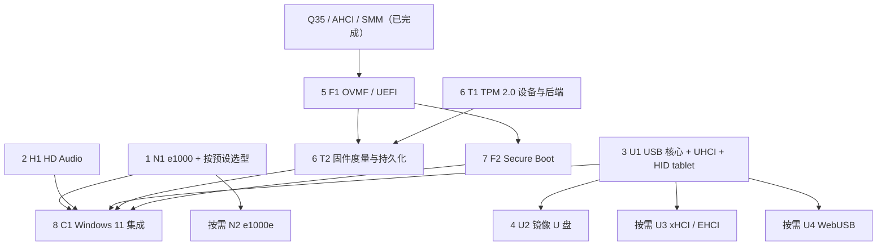

# 现代 PC 设备与 UEFI 安全启动实施计划

状态：设计与实施计划，尚未实现。2026-10-03 初稿；2026-10-23 按 master（`c9e1f0e0`）复核，
改为按实施优先级排列，网卡改为“按机器自动选型、所有目标客体免驱”。

本计划为 v86 增加现代客体用自带驱动即可工作的设备：e1000 网卡、HD Audio、USB（UHCI、
HID tablet、镜像 U 盘），然后是 OVMF、TPM 2.0 与 Secure Boot；xHCI、e1000e 和 WebUSB 按需
扩展。库的默认机器保持不变；新设备是显式选项，由 VM 管理器的系统预设选用
（[vm-manager.md](vm-manager.md)）。

本计划与 Q35（[q35.md](q35.md)、[ahci.md](ahci.md)、[sata.md](sata.md)）共用平台、PCI、MMIO、
中断与存储基础，Q35 已经实现。网卡、声卡和 USB 在 i440FX 与 Q35 上都要可用；固件以 Q35
为主。ARM64 virt（[virt.md](virt.md)、[ARM64 virt 与 Android 16 计划](arm64-virt-android16-plan.md)）
不新增设备：它的网卡、声卡和输入设备已经是 Android 与 Linux 自带驱动的 virtio 设备（见 N1）。

## 复核结论

2026-10-23 的复核改动了以下内容：

1. **网卡**：没有一种模拟网卡能在 Android 16 aarch64、Windows 7/8.1/10 和 Linux x86-64 上
   同时免驱（证据见 N1）。改为一个网络后端、两种前端：x86/x86-64 用 Intel 82540EM（e1000），
   ARM64 virt 用已有的 virtio-net，由系统预设自动选择。用户只选系统，不选型号，也不装驱动。
   e1000 从“可并行”升为第一优先级。
2. **USB 先做 UHCI**：初稿先做 xHCI，但 Windows 7 及更早没有 xHCI 驱动。UHCI 的驱动在 XP
   与 Windows 8.1 中已核对为自带，Linux 也有，实现规模远小于 xHCI；HID tablet 是全速设备，
   不需要 USB 2/3。xHCI 改为按需。
3. **HD Audio 提前到第二**：Windows 8.1 与 Vista/7/10 预设现在是 `nic: "none"`、`sound: "none"`
   （[guest_presets.js](../src/app/guest_presets.js) 列为已知问题），网卡和声卡是这批系统最缺的两项。
4. **“当前分支基础”已过时**：块内精确 MMIO（`mmap_register_range`）、BAR 重定位、总线主控
   门控、单向量 MSI、Q35 的 SMM/TSEG、共享块后端 [block_backend.js](../src/block_backend.js)，以及
   按虚拟时钟消耗 PCM 的 [virtio_snd.js](../src/virtio_snd.js) 都已存在。初稿的大 P0 拆开，各项随
   第一个用到它的阶段落地；e1000、HDA 和 UHCI 都用 INTx，不等 MSI-X。
5. **OVMF 的第一个阻塞点**：v86 的 fw_cfg 对 `FW_CFG_ID` 返回 0，而 edk2 的 `QemuFwCfgLib` 在
   revision < 1 时认为没有 fw_cfg（见 F1）。
6. **Secure Boot 路线调整**：Q35 已有 SMM，标准 OVMF Secure Boot 构建（SMM + pflash）在 v86 侧
   只需 pflash 与 SMI 广播，验签留在固件里；PV 变量服务则要在 v86 里实现 PKCS#7 验签。改为
   先评估 SMM 路线。
7. **e1000e 降为按需**：82540EM 已覆盖 Vista 到 Windows 11；82574L 的驱动在 Windows 11 中是
   可移除的 Feature on Demand。

## 优先级总览

| 顺序 | 阶段 | 首个交付 | 用自带驱动的客体 | 前置 | 规模 | 排序理由 |
| --- | --- | --- | --- | --- | --- | --- |
| 1 | N1 网卡 | e1000（82540EM）与按预设选型；ARM64 沿用 virtio-net | Vista/7/8/8.1/10/11（x86、x64），Linux x86/x86-64；Android 与 Linux aarch64 | 无（传统 PCI、INTx） | 中 | 所有者的直接需求；现有 Windows 预设没有可用网卡 |
| 2 | H1 HD Audio | ICH6/ICH9 HDA 与通用输出 codec | Vista 及以后，Linux（不含 XP） | 无（INTx，可选 MSI） | 中 | 同一批预设没有声卡；Vista 以后没有 SB16 驱动 |
| 3 | U1 USB 核心、UHCI、HID tablet | 不需 pointer lock 或 VMware Tools 的绝对坐标指针 | XP 到 Windows 11（XP、8.1 已核对），Linux | 无 | 中 | UHCI 覆盖 XP 到 11；xHCI 只覆盖 Windows 8 以后 |
| 4 | U2 镜像 U 盘 | BOT/SCSI，可热插拔 | XP 及以后，Linux | U1 | 中小 | 复用 U1 与 `block_backend.js`；SATA/PCIe 热插拔已有，排在三项缺失设备之后 |
| 5 | F1 OVMF / UEFI | Shell、GOP、GPT/ESP 冷启动、持久变量 | — | Q35（已完成） | 很大 | Windows 11 与纯 UEFI 镜像的前提；8.1/10 用 SeaBIOS 已能启动 |
| 6 | T1/T2 TPM 2.0 | CRB 前端与 libtpms 后端；T2 接入 OVMF 度量 | Windows 8 以后（`tpm.inf`），Linux | T1 无；T2 需 F1 | 大 | Windows 11 的前提 |
| 7 | F2 Secure Boot | 受保护变量与验签正反例 | — | F1；SMM 路线另需 pflash | 大 | 完整安全启动 |
| 8 | C1 Windows 11 集成 | 固定镜像的安装、运行与安全功能证据 | — | 1–7 | 中 | 汇总验收 |
| 按需 | U3 xHCI（必要时 EHCI） | USB 2/3、更多端口 | Windows 8 以后，Linux | U1，按型号的 MSI/MSI-X | 大 | 只在 UHCI 的吞吐或兼容性不够时 |
| 按需 | N2 e1000e（82574L） | PCIe 网卡 | 8.1 有；11 中为可移除 FOD | N1，MSI-X | 中 | 只在某个目标镜像缺 82540EM 驱动时 |
| 按需 | U4 WebUSB | 受限直通 | — | U1 | 中 | 浏览器限制多，不阻塞任何交付 |

1–3 互不依赖，可以并行；每个阶段通过自己的验收矩阵后单独发布，不等后面的阶段。OVMF、
vTPM 移植和 Windows 驱动身份的小型探测可以提前做，以尽早暴露阻塞（F1 的 fw_cfg 问题就是
这样找到的）。



## 当前分支基础

以下为 2026-10-23 对 master（`c9e1f0e0`）代码和文档的审查结果；本次没有重新运行客体启动测试。

| 入口 | 现状 | 本计划要补的部分 |
| --- | --- | --- |
| [x86-64.md](x86-64.md)、`src/rust/x64/` | long mode、36 位物理地址、x64 页层；`cpu_features` 可到 x86-64-v2/v3（SSE4.2、POPCNT、AVX2 等）；Windows 8.1 x64 已到桌面 | Windows 11 目标镜像的 CPUID/MSR/启动日志清单（C1） |
| [src/pci.js](../src/pci.js) | BAR 探测与重定位（`on_move`）、桥转发、总线主控门控 DMA 与 MSI、单向量 64 位 MSI（`msi_capability`、`msi_notify`；AHCI 与 PCIe root port 在用；地址高 32 位非零时丢弃）、root port 与热插拔 | MSI-X，只在 U3/N2 需要时 |
| [src/io.js](../src/io.js) | 128 KiB 粗块之外，`mmap_register_range` 在块内按精确范围分发（小 BAR、芯片组寄存器块） | 新设备直接使用，无需新机制 |
| [src/cpu.js](../src/cpu.js)、[src/extended_memory.js](../src/extended_memory.js) | `validate_physical_range`、`read_blob_physical`、`write_blob_physical`，跨页与高地址 | 各设备的环、长度与总量上限 |
| [src/acpi_tables.js](../src/acpi_tables.js)、[src/platform.js](../src/platform.js)、[src/cpu.js](../src/cpu.js) | ACPI 表经 fw_cfg 的 `etc/table-loader`（QEMU 格式）交给固件，按固件写入的 PMBA 生成；fw_cfg 只有 PIO，`FW_CFG_ID` 返回 0 | OVMF 需要的 fw_cfg 修订号与文件（F1）、TPM2 表（T1） |
| [src/q35.js](../src/q35.js)、[src/rust/cpu/smm.rs](../src/rust/cpu/smm.rs) | ICH9、AHCI、HPET、SMBus、TCO；SMM：逐核 SMI 锁存、32/64 位保存区、SMRAM、高 SMRAM、TSEG、RSM | OVMF 的 SMI 广播协商、pflash 写保护（F1、F2） |
| [src/browser/mouse.js](../src/browser/mouse.js)、[src/ps2.js](../src/ps2.js)、[src/vmware.js](../src/vmware.js)、[src/virtio_input.js](../src/virtio_input.js) | PS/2；VMware 绝对坐标（客体须装 VMware Tools）；ARM64 的 virtio tablet | USB HID 路径与统一输入路由（U1） |
| [src/block_backend.js](../src/block_backend.js)、[src/buffer.js](../src/buffer.js)、[src/disk_writeback.js](../src/disk_writeback.js)、[src/state_io.js](../src/state_io.js) | 共享块后端：复位取消读、flush 顺序、快照等待在途 I/O、`report`/`stop` 错误策略；写回持久化（[disk-persistence-plan.md](disk-persistence-plan.md)） | BOT/SCSI 前端（U2） |
| [src/sb16.js](../src/sb16.js)、[src/virtio_snd.js](../src/virtio_snd.js)、[src/browser/speaker.js](../src/browser/speaker.js) | SB16；virtio-snd 按 MachineClock 消耗 PCM、按时归还缓冲；`dac-*` 通道没有来源标识 | HDA 控制器与 codec（H1） |
| [src/ne2k.js](../src/ne2k.js)、[src/virtio_net.js](../src/virtio_net.js)、[networking.md](networking.md) | NE2000 PCI（RTL8029，`10EC:8029`）、virtio-net（virt 上可多张）；fetch、wisp、wsproxy、inbrowser 后端经 `net{id}-send/receive/mac` 连接 | e1000 前端（N1） |
| [src/app/guest_presets.js](../src/app/guest_presets.js)、[src/browser/vm_options.js](../src/browser/vm_options.js)、[v86.d.ts](../v86.d.ts) | 系统预设；arm64 强制 virtio-net；`net_device.type` 只有 `"ne2k"`、`"virtio"`；Windows 预设为 `nic: "none"`、`sound: "none"` | 新类型与预设默认值 |
| [src/browser/cpu_worker.js](../src/browser/cpu_worker.js)、[src/browser/cpu_worker_runtime.js](../src/browser/cpu_worker_runtime.js) | 设备与 RAM 在 CPU Worker，页面适配器经消息通信 | 新选项的序列化；WebUSB 权限代理（U4） |
| [src/virt/](../src/virt/)、[virt.md](virt.md) | ARM64 virt：GICv3 无 ITS（没有 MSI），PCIe 只有 INTx，virtio-pci 没有 MSI-X | 不新增设备 |

仓库里还没有 USB 栈（UHCI、EHCI、xHCI）、HDA、e1000、OVMF、Secure Boot 或 TPM 的实现。
[virtio.js](../src/virtio.js) 的 `msix_*` 字段只是占位，不能当作已有 MSI-X。

## 公共约定

初稿的 P0 是先行的大阶段。复核后只保留下面的约定，每一项在第一个用到它的阶段里实现和测试。

### API 与配置

以下为拟新增接口，字段名在对应阶段冻结，不能当作当前可运行的示例：

```js
new V86({
    cpu_type: "x86_64",
    machine_type: "q35",
    acpi: true,
    cpu_cores: 2,
    net_device: { type: "e1000", relay_url: "..." }, // N1："ne2k" | "virtio" | "e1000"
    audio_device: { type: "hda" },                   // H1："sb16" | "hda" | "none"
    usb: {                                           // U1、U2
        controller: "uhci",                          // U3 以后可为 "xhci"
        tablet: true,
        mass_storage: [
            { id: "usb-disk0", image: { url: "usb.img", async: true }, read_only: false },
        ],
    },
    firmware: {                                      // F1、F2
        type: "uefi",                                // 默认仍是 bios/vga_bios
        code: { url: "OVMF_CODE.fd" },               // 示例名；CODE 与变量模板必须配套
        vars: { store_id: "vm-demo/uefi" },
        secure_boot: false,
    },
    tpm: { version: "2.0", interface: "crb", store_id: "vm-demo/tpm" }, // T1
    // RAM、显示适配器、hda/cdrom 等继续按现有及 Q35 的选项配置。
});
```

- `hda` 已表示第一块硬盘，HD Audio 用新增的 `audio_device`。
- 库的默认值不变：SB16、NE2000、PS/2、SeaBIOS。新设备由 VM 管理器的预设
  （[guest_presets.js](../src/app/guest_presets.js)）选用；设置对话框只列当前机器能用的型号
  （arm64 只有 virtio，与 [vm_options.js](../src/browser/vm_options.js) 一致）。
- 首版 SB16 与 HDA 二选一；以后要共存，先给 `dac-*` 加来源标识并实现混音，不能共用无来源
  标识的队列。
- UEFI 与 `bios/vga_bios` 互斥，CODE/变量模板的版本组合在启动前校验。`secure_boot: true`
  表示要求加载并核验受信配置，不是一个对外可见的状态位。
- USB 设备有稳定 ID 和端口号；热插拔 API 有明确的成功、失败、取消和断开事件。Node 支持
  模拟设备，WebUSB 是可选的浏览器适配器。
- 新选项贯穿 [v86.d.ts](../v86.d.ts)、starter、CPU Worker、CPU 初始化、reset、destroy、快照和构建
  入口（新源文件要进 Makefile 的 Closure 文件列表）；快照不保存浏览器权限对象、Promise 或打开
  的句柄。
- 固件变量、TPM 和可写介质的存储属于同一个 VM 身份，复用 VM 管理器的磁盘存储（浏览器磁盘、
  磁盘服务）；不同 VM 不能意外共用状态。

### PCI、DMA、中断和时钟

1. 新设备使用现有 PCI 机制：BAR 声明与 `on_move` 重定位、`mmap_register_range` 映射小 BAR、
   总线主控关闭时不 DMA、INTx 与同线共享（Q35 为 PIRQ E–H，GSI 16 以上）。每个设备在
   `pci_functions`（[platform.js](../src/platform.js)）里为 i440FX 的 v86 布局、QEMU 兼容布局和 Q35
   各定一个位置，并与 ACPI 的 `_PRT` 一致。
2. DMA 使用 `validate_physical_range`、`read_blob_physical`、`write_blob_physical`，另按设备规则
   检查对齐、长度、链环、地址溢出与总量上限。保留地址高位；超出 36 位总线的地址返回设备
   错误，不回绕到低内存。
3. 中断：e1000（82540EM）与 UHCI 不提供 MSI，只用 INTx；HDA 可以加 [pci.js](../src/pci.js) 已有的单向量
   MSI，先以 INTx 验证。MSI-X（table/PBA、mask/pending、多向量）只在 U3/N2 需要时实现。写回
   的描述符或状态必须先于中断可见；不暴露没有实现的 capability。
4. 设备计时用 [MachineClock](../src/machine_clock.js)：e1000 的 ITR 与延迟定时器、HDA 的 WALLCLK
   与 DMA 消耗、UHCI 的 1 ms 帧。VM `pause()` 冻结虚拟时钟和设备计时；页面隐藏、静音或权限
   未授予不阻断客体的硬件进度。在途宿主 I/O 可以结束，客体可见的完成按统一的暂停/恢复规则
   提交。每轮处理有预算，描述符环、帧表或 doorbell 不能一次占满页面或 Worker。

### 异步 I/O、复位和快照

各设备从首个版本就有 `reset/get_state/set_state/destroy` 或等价生命周期；快照记录设备型号、
schema、固件和后端状态版本，状态槽位在 [state.js](../src/state.js) 统一分配。旧快照缺少新设备时
按旧布局恢复；设备组合不同或格式不兼容时，在修改 RAM 之前失败。

异步请求带 machine/device epoch：旧请求晚到不得写入新机器的 RAM、推进新队列或发 IRQ。
磁盘类请求走 [block_backend.js](../src/block_backend.js)，它已处理复位取消、flush 顺序、快照等待
（[state_io.js](../src/state_io.js)）和错误策略；写入一旦提交，复位不能撤销。长轮询的 USB IN、
断开的 WebUSB 和超时的后端要有取消或脱离策略，保存快照不能无限等待。关机和 S5 时的持久化
失败必须可观测，不能默默丢弃。

## 1. N1 网卡：一个后端，按机器选两种免驱前端

### 结论

| 机器 | 默认网卡 | 用自带驱动的客体 |
| --- | --- | --- |
| x86 / x86-64（i440FX、Q35） | Intel 82540EM（e1000，`8086:100E`，子系统 `8086:001E`），新增 | Windows Vista 到 11（x86、x64；8.1 已核对 INF，其余依据 VirtualBox 默认值，待实际镜像核对），Linux x86/x86-64 |
| ARM64 virt | virtio-net，已有 | Android 16 aarch64（Cuttlefish），Linux aarch64 |
| 旧客体（DOS、Windows 9x、NT、2000、XP） | NE2000 PCI（RTL8029），已有，不变 | XP SP3 等（XP 自带 `netrtpnt.inf`） |

效果与 XP 认出 NE2000 相同：用户选系统预设，客体第一次启动就有网络，不装驱动。但它不是
“一张卡”：下面的证据表明，没有任何一种模拟网卡在 Android 16 aarch64、Windows 7/8.1/10 和
Linux x86-64 上都有自带驱动。这三类客体运行在两种机器上（Android 只在 ARM64 virt 上，Windows
只在 x86 上），每种机器配一张卡就够了。

### 选型证据（2026-10-23 核对）

| 候选（PCI ID） | Android 16 aarch64 | Windows 7 | Windows 8.1 x64 | Windows 10 | Linux x86-64 |
| --- | --- | --- | --- | --- | --- |
| virtio-net（`1AF4:1000/1041`） | **有**：vendor ramdisk 加载 `virtio_net.ko` | 无，需 virtio-win | **无**：没有 INF 匹配 | 无，需 virtio-win | 有 |
| e1000 82540EM（`8086:100E`） | **无**：`CONFIG_E1000` 未设 | 有（VirtualBox 默认） | **有**：`nete1g3e.inf` | 有（VirtualBox 默认） | **有**：Alpine virt 的 `e1000.ko`；linux4.iso 内置 |
| e1000e 82574L（`8086:10D3`） | 无：`CONFIG_E1000E` 未设 | 未核对 | 有：`net1ic64.inf` | 未核对；Windows 11 中为可移除 FOD | 有：`e1000e.ko` |
| RTL8139（`10EC:8139`） | 无 | 未核对 | 有：`netrtl64.inf` | 未核对 | Alpine virt 无（`NET_VENDOR_REALTEK` 未设） |
| RTL8168（`10EC:8168`） | 无：`CONFIG_R8169` 未设 | 未核对 | 有：`netrt630x64.inf` | 未核对 | Alpine virt 无 |
| Intel 8255x（`8086:1229`） | 无 | 未核对 | 有：`netefe3e.inf` | 未核对 | Alpine virt 无（`CONFIG_E100` 未设） |
| NE2000 PCI RTL8029（`10EC:8029`，现有） | 无 | Vista 起需第三方驱动（[windows-nt.md](windows-nt.md) §5.3） | **无** | 未核对 | Alpine virt 无；linux4.iso、buildroot 内置 |
| USB CDC-ECM/NCM、RTL8153、AX88179 | 模块在 system_dlkm，但不加载（见下） | 未核对；没有 xHCI 驱动 | 无 CDC-ECM/NCM；RTL8153、AX88179 有 | 未核对 | Alpine virt 无（`USB_NET_DRIVERS` 未设） |
| USB RNDIS | 无：`CONFIG_USB_NET_RNDIS_HOST` 未设 | 未核对 | 有：`rndiscmp.inf` | 未核对 | Alpine virt 无 |

来源：

- **Android**：Cuttlefish `aosp_cf_arm64_only_phone-userdebug` 15581820（android16-qpr2，内核
  `6.12.38-android16-5`），由 [tools/a64_android.mjs](../tools/a64_android.mjs) 下载到 `build/a64-android/`。
  内核内嵌配置里没有任何 PCI 以太网驱动（e1000、e1000e、r8169 未设，virtio_net 是厂商模块）；
  xHCI 与 EHCI（含 PCI 接口）、USB HID、USB 存储都内置。vendor ramdisk 的 `modules.load` 只有
  virtio 等 19 个模块。system_dlkm 带 `usbnet`、`cdc_ether`、`cdc_ncm`、`r8152`、`ax88179_178a`、
  `asix` 等，但它的 `modules.load` 是空的，vendor 与 system 的 `ueventd.rc` 都没有
  `modalias_handling`；`runs/` 下 29 次启动的内核日志只注册了 vendor_dlkm 的 4 个 USB 驱动，从未
  出现 USB 网卡驱动。
- **Windows 8.1**：`windows81_full.iso` 中 `install.esd` 第 1 个映像的 `Windows/Inf` 与 DriverStore，
  共 1228 个 INF。`nete1g3e.inf`（Microsoft 提供，Intel 8.4.13.0，`E1G6032E.sys`）匹配
  `PCI\VEN_8086&DEV_100E&SUBSYS_001E8086`（PRO/1000 MT Desktop）和通用的 `PCI\VEN_8086&DEV_100E`。
- **Windows 7/10**：本地没有镜像。VirtualBox 的客体类型表
  （[Global.cpp](https://github.com/VirtualBox/virtualbox/blob/main/src/VBox/Main/src-all/Global.cpp)）对
  Windows Vista/7/8/8.1/10（x86、x64）和 Windows 11 x64 默认都是 `I82540EM`，对 32 位 XP 是
  `I82543GC`；VirtualBox 不为这些网卡提供驱动，默认值依赖客体自带驱动。表中“未核对”在拿到
  镜像后补齐（见“测试镜像”）。
- **XP SP3**：`windowsxp.iso` 的 I386 下 827 个 INF：有 RTL8029、RTL8139、PCnet、82543GC
  （`nete1000.inf`）和 8255x，没有 82540EM。osinfo-db 把 e1000 列为 XP 的支持设备，与光盘不符，
  所以不拿它作依据。
- **Linux**：Alpine 3.24 x86_64 virt（6.18.35）有 e1000、e1000e、virtio_net、vmxnet3 模块，没有
  Realtek、NE2000、e100 和任何 USB 网卡驱动；`images/linux4.iso`（4.16）内置 e1000、e1000e、
  ne2k-pci、virtio_net；`images/buildroot-bzimage68.bin` 内置 ne2k-pci 与 virtio_net，没有 e1000、
  USB 主机驱动和 snd-hda-intel。

为什么不追求一张卡：

- virtio-net 在 Windows 上要装 virtio-win；所有 PCI 网卡在 Android GKI 中都没有驱动。
- USB 网卡也不成立：Android 不加载这些模块；RNDIS 在 Android GKI 中没有编译，CDC-ECM/NCM 在
  Windows 8.1 中没有驱动；Alpine virt 没有任何 USB 网卡驱动；而且要先完成整个 USB 栈。让
  Android 加载 USB 网卡模块需要改镜像，等同于装驱动。

为什么 x86 选 82540EM：

- 覆盖面最大：Vista 到 Windows 11 的 VirtualBox 默认网卡；Windows 8.1 的 INF 有专门匹配
  VirtualBox 所用子系统号的条目；Linux 的 e1000 在最小的 Alpine virt 内核和 linux4.iso 中都有。
- 实现简单：传统 PCI、INTx，不依赖 MSI、MSI-X 或 PCIe 能力，i440FX 与 Q35 都能用。
- 有两个成熟实现可对照：QEMU 的 `e1000.c` 与 VirtualBox 的 `DevE1000.cpp`。
- 比 NE2000 快：描述符环一次处理一批包，几次 MMIO 换一批数据；NE2000 每个包要几百次端口 I/O。
- 其他候选各缺一块：82574L 在 Windows 11 中是可移除 FOD，且需要 PCIe/MSI-X；RTL8139、
  RTL8168、8255x 在 Alpine virt 中没有驱动，在 Windows 10/11 中也未核对；RTL8139 与 8255x 只有
  10/100 Mbit/s。

### 自动选型

- 库 API：`net_device.type` 增加 `"e1000"`；库默认保持 `"ne2k"`（兼容旧页面、旧快照和旧客体）。
- VM 管理器预设（[guest_presets.js](../src/app/guest_presets.js)）：
  - Windows 8.1、Windows Vista/7/10（以后的 11）：`nic: "e1000"`，取代现在的 `"none"`，并删除
    `WINDOWS_81_ISSUES` 中 “ne2k has no Windows 8.1 driver” 一条。
  - Linux x86_64：保持已验证的 `virtio`；e1000 同样免驱，作为设置对话框里的备选。
  - DOS、Windows 3.x/9x/NT/2000/XP、Linux 32 位：保持 `ne2k`（buildroot 测试内核只带 ne2k-pci）。
  - arm64、Android：保持 `virtio`（[vm_options.js](../src/browser/vm_options.js) 已对 arm64 强制）。
- 设置对话框的网络适配器列表按机器给出型号：x86 为 NE2000、e1000、virtio-net；ARM64 只有
  virtio-net。

### 设备契约（82540EM）

参照 Intel 8254x 软件开发手册与 QEMU、VirtualBox 的实现，按 82540EM 这一个型号实现完整的
必要契约：

- **PCI**：`8086:100E`，class `02/00/00`，子系统 `8086:001E`；BAR0 为 128 KiB MMIO，另有 I/O BAR
  （IOADDR/IODATA 间接访问）；INTA；PCI 电源管理 capability；不提供 MSI（与 QEMU、VirtualBox
  相同）。位置写入 `pci_functions`
  （与现在 NE2000 的网卡位置一致），三种布局各一个。
- **EEPROM 与 PHY**：64 字 EEPROM，经 EERD 和 EECD 位操作两条路径读取，校验和使总和为
  `0xBABA`；MAC 来自 EEPROM 与 RAL/RAH[0]。PHY 经 MDIC 访问，PHY ID 与 82540EM 配套：Intel 的
  Windows 驱动在 MAC 与 PHY 不匹配时拒绝初始化（QEMU `e1000.c` 的注释）。link、自协商完成、
  STATUS 的速率与双工位和 PHY 一致；实现 CTRL.RST 与 PHY 复位。
- **发送**：legacy 描述符与 context/data 描述符；IP/TCP/UDP 校验和插入、TSO 分段、VLAN 插入；
  TDH/TDT 环，RS 时回写 DD，TXDW/TXQE 中断。Windows 自带驱动与 Linux e1000 默认都启用校验和
  卸载和 TSO，所以这些属于首版契约，不是后续扩展；验收用驱动的默认配置，关闭 offload 只用于
  调试并单独记录。
- **接收**：legacy 描述符，RCTL.BSIZE/BSEX 决定缓冲大小，大包跨描述符直到 EOP；单播 RA、多播
  MTA 哈希、广播、混杂与 VLAN 过滤；LPE、SECRC；RXCSUM（IPCS/TCPCS 或 IXSM）；没有可用描述符
  时计 MPC 并置 RXO，不默默丢包；短帧、超长帧与 ring wrap 分别处理。
- **中断**：ICR 读清，IMS/IMC/ICS；ITR 与 RDTR/RADV/TIDV/TADV 定时器按 MachineClock 推进。中断
  合并直接决定 v86 中每个包的开销。INTx 为电平语义，ICR 清零后释放 INTA。
- **统计与杂项**：统计寄存器读清；LEDCTL、PBA、WUC/WUFC、MANC 等驱动会访问的寄存器有确定值。
- **后端**：复用 `net{id}-send/receive/mac` 总线，MAC 的恢复与转换和现有前端一致；设备报告
  1 Gbps 链路不代表浏览器能达到该吞吐。
- **生命周期**：reset、快照与恢复、epoch；描述符与缓冲经公共 DMA 接口，总线主控关闭时停止 DMA。

### 验收

- Node 设备测试（`tests/devices/`）：构造 TX/RX 环与回绕、跨描述符包、TSO 与校验和向量、
  EEPROM 校验和、ICR/IMS 语义、中断合并定时与快照往返。
- Linux：`images/linux4.iso`（内置 e1000）作快速客体，Alpine 3.24 x86_64 virt（`e1000` 模块，
  [tests/x64/linux_boot.mjs](../tests/x64/linux_boot.mjs) 所用的镜像）作现代内核。DHCP、ARP、DNS、
  TCP/UDP 双向收发；与可控回环端点做至少 1 GiB 双向传输并校验；link down/up、reset、快照、多核
  中断；记录吞吐、CPU 与 IRQ 速率。协议测试与依赖外网的测试分开。
- Windows 8.1 x64：现有镜像与 [tests/x64/windows_boot.mjs](../tests/x64/windows_boot.mjs)。设备管理器的
  `ConfigManagerErrorCode` 为 0，记录绑定的 INF 与驱动版本；DHCP 获得地址，HTTP 下载并校验。
- Windows 7（x86、x64）与 Windows 10 x64：需要所有者提供安装介质或已安装镜像；每个镜像记录
  绑定的 INF、驱动版本与硬件 ID。Windows 11 在 C1 中核对。
- ARM64：现有 virtio-net 测试与 Android 16 门禁保持通过（不改设备）。
- 回归：旧预设（NE2000）与旧快照照常工作。

## 2. H1 HD Audio

Vista 以后没有 SB16 驱动，Windows 8.1 与 Vista/7/10 预设现在没有声卡。HD Audio 用自带驱动即可
工作：

| 客体 | 自带驱动 |
| --- | --- |
| Vista 及以后 | 总线驱动 `hdaudbus.inf` 按类匹配 `PCI\CC_0403`，通用 codec 驱动 `hdaudio.inf` 匹配 `HDAUDIO\FUNC_01`（8.1 已核对） |
| Linux | `snd-hda-intel` 与通用 codec 驱动（Alpine virt 为模块，linux4.iso 内置） |
| XP SP3 | 只有总线驱动，没有通用 codec 驱动（光盘已核对）：XP 继续用 SB16 |
| ARM64 | 不需要：已有 virtio-snd |

建议拆为 `src/hda.js` 控制器、`src/hda_codec.js` codec 和可复用的 PCM 路径。控制器身份：i440FX
用 ICH6（`8086:2668`），Q35 用 ICH9（`8086:293E`），与 QEMU 的 `intel-hda`、`ich9-intel-hda` 相同；
Windows 按类匹配，Linux 两个 ID 都认。codec 用通用输出 codec（参照 QEMU `hda-codec.c` 的
`hda-output`），不冒充需要大量私有初始化的真实 codec。

控制器覆盖 GCTL/CRST、GCAP、STATESTS、CORB/RIRB 地址/指针/大小/复位、verb response、中断
状态/屏蔽、stream descriptor、BDL、LPIB、CBL/LVI、格式和 DMA position buffer。实现驱动会使用的
immediate command 路径；公布几个 stream、环大小或 64 位 DMA，就实现对应语义。首先只公布最小
可用的输出 stream，输入以后增加。中断先用 INTx，可选 pci.js 已有的单向量 MSI。

codec 至少有 root、Audio Function Group、DAC 和 output pin，正确返回 widget、PCM 格式与连接列表
能力；支持 stream/channel 绑定、converter format、pin control、amplifier/mute、power 和 reset verbs。
设备管理器看到 HDA 控制器只是第一步；codec 拓扑被通用驱动接受并产生音频 endpoint 才算枚举完成。

先实现 48 kHz/16 位/立体声，只公布实际支持的格式，再扩展 44.1 kHz 和其他位宽。时钟模型沿用
[virtio_snd.js](../src/virtio_snd.js)：WALLCLK（24 MHz）、DMA 消耗、LPIB 和周期 IRQ 都按 MachineClock
推进；浏览器未解锁音频、页面静音或没有输出设备时，客体 PCM 照常消耗，中断照常产生。
AudioWorklet 的拉取只是播放后端的需求，不能成为控制器唯一的时钟。

PCM 经现有的 `dac-send-data` 送到 [speaker.js](../src/browser/speaker.js)（与 virtio-snd 相同），补上
格式、队列上限、重采样与暂停/恢复语义。输出队列不跨快照重放：恢复时丢弃旧 epoch 的样本，
以客体 stream 状态重建。录音另设阶段，播放不需要麦克风权限。

验收：Linux ALSA（linux4.iso、Alpine）与 Windows 8.1 的自带驱动，然后是 Vista/7/10/11 镜像；自动
检查生成 PCM 的频率/声道/样本数和 DMA/IRQ，浏览器检查可听输出。连续播放至少 10 分钟，记录
underrun、overflow、延迟和漂移；覆盖格式变更、静音、暂停、reset、快照、Worker 与后台切换。
预设：Windows 8.1、Vista/7/10 改为 `sound: "hda"`，删除 “No sound card” 一条已知问题。
[Microsoft HDA 总线驱动](https://learn.microsoft.com/en-us/windows-hardware/drivers/audio/hd-audio-bus-driver)

## 3. U1 USB 核心、UHCI 与 HID tablet

### 为什么先做 UHCI

| 控制器 | Windows 自带驱动 | Linux | 规模 |
| --- | --- | --- | --- |
| UHCI（USB 1.1） | `usbport.inf` 按类匹配 `PCI\CC_0C0300`：XP SP3、8.1 已核对 | `uhci-hcd` | 小：I/O 寄存器、帧表、TD/QH |
| EHCI（USB 2.0） | `usbport.inf`（`CC_0C0320`）：XP SP3、8.1 已核对 | `ehci-hcd` | 中：异步与周期调度、companion 路由 |
| xHCI | 只有 Windows 8 以后（`usbxhci.inf`）；Windows 7 没有 | `xhci-hcd` | 大：上下文，命令/传输/事件环，MSI/MSI-X |

HID tablet 是全速设备，UHCI 足够；UHCI 覆盖 XP 到 Windows 11，xHCI 只覆盖 Windows 8 以后
（[Microsoft USB 3.0 驱动栈](https://learn.microsoft.com/en-us/windows-hardware/drivers/usbcon/usb-3-0-driver-stack-architecture)）。
Vista/7/10/11 的 UHCI 驱动在拿到镜像后逐个核对。ARM64 已有 virtio tablet，不需要 USB。

### 模块划分

建议新增 `src/usb/`：`uhci.js`（控制器）、`usb_device.js`（设备模型与标准请求）、`hid_tablet.js`、
`mass_storage.js`（U2）和共享的描述符/常量模块。控制器只处理寄存器、调度、DMA 和端口；设备
处理标准与类请求；镜像和浏览器适配器属于后端。设备层与控制器无关，U3 的 xHCI/EHCI 直接复用。
模拟 USB 事务，不实现电气信号。

### UHCI 控制器

- **身份与位置**：i440FX 用 PIIX3 的 USB 功能（`8086:7020`；QEMU 兼容布局中在 `00:01.2`，与 QEMU
  的 `-usb` 相同；v86 布局另选空位）；Q35 用 ICH9 UHCI（`8086:2934`，`00:1d.0`，与 QEMU
  `ich9-usb-uhci1` 相同）。BAR4 为 32 字节 I/O 空间；配置空间 `0x60` 的 SBRN 为 `0x10`；`0xC0` 的
  LEGSUP 按规范可写，v86 没有 USB legacy SMI，陷阱位不产生 SMI。中断用 INTx。
- **寄存器**：USBCMD（RS、HCRESET、GRESET、EGSM、FGR、CF、MAXP）、USBSTS（USBINT、ERROR、RD、
  HSE、HCPE、HCHalted，W1C）、USBINTR、FRNUM、FLBASEADD、SOFMOD、PORTSC1/2（CCS/CSC、PE/PEC、
  LS、RD、LSDA、PR、SUSP）；两个根端口。
- **调度**：1024 项帧表，QH 与 TD 链表（T、Q、Vf 深度/广度优先）；TD 的 ActLen、状态（Active、
  Stalled、NAK、CRC/Timeout、Babble、Bitstuff）、C_ERR、SPD 与 IOC/IOS。短包、STALL、NAK、断开分别
  处理，NAK 不当成成功的零长度包。首版不做等时传输（没有用到它的设备）。
- **时间**：帧按 MachineClock 每 1 ms 推进，在 CPU 让出时批量补齐；落后太多时只补到预算为止，
  中断端点的轮询照常 NAK，不影响正确性。每帧处理的字节数是参数，不按真实的 12 Mbit/s 节流，
  但要有上限，并识别 QH 回环（带宽回收），防止一帧之内无限循环。
- **电源**：全局 suspend/resume、端口 suspend、远程唤醒（tablet 声明 remote wakeup 时，Windows
  会挂起空闲设备）；PCI PM 的 D0/D3。整机公布 S3 时验证休眠/唤醒与设备恢复；未验证的新平台
  关闭对应的 ACPI 睡眠能力声明，不沿用旧机器的通过记录。
- **固件**：SeaBIOS 若在 POST 时驱动 UHCI 与 tablet，移交操作系统前要停止调度，客体驱动的
  HCRESET 与 LEGSUP 写入要能接管控制器。

### USB 设备核心

设备地址、配置与接口状态；控制传输三阶段与 SETUP 中止；标准请求（描述符、地址、配置、接口、
GET_STATUS、CLEAR/SET_FEATURE 的 halt 与 remote wakeup）；interrupt 与 bulk 端点、data toggle、STALL
与 halt 清除。SET_ADDRESS 之后，控制器侧与设备侧的地址状态保持一致。

### HID tablet

采用通用 HID 绝对定位 pointer：X/Y 为 16 位绝对值（例如 logical range 0–32767），包含鼠标按钮
和相对滚轮。这里的 tablet 是绝对坐标鼠标设备，首版不承诺压感笔、多点触控或 Windows Ink。报告
描述符的 Usage、Collection、绝对/相对位与实际 payload 必须一致。不声明无法兑现的 Boot Mouse
协议；覆盖 HID descriptor/report、GET/SET_REPORT、GET/SET_IDLE 及实际声明协议所需请求。

输入链路为：页面指针 → 客体显示内容矩形内的归一化坐标 → 统一输入路由 → HID 报告。复用显示
布局提供的数据，不把外层 canvas 边框、留黑或 CSS 像素直接当成客体像素。考虑 devicePixelRatio、
页面缩放、全屏、动态分辨率、指针离开、失焦与拖动捕获。首版固定单显示器；多显示器的坐标范围
另行定义。

同一指针事件只进入一个客体路径：USB tablet、VMware 绝对坐标或 PS/2。切换时释放已按下的按钮，
避免双击、双光标移动和卡住的按键。绝对坐标路径不要求 pointer lock；游戏需要的相对移动作为
显式模式保留，页面能一键切回 PS/2 相对模式。鼠标尚未枚举时的回退不能造成重复输入。Win9x
对 HID 绝对坐标的支持未核对，不作承诺，Win9x 预设继续用 PS/2。

验收：Node 构造帧表、QH 与 TD，验证边界与 DMA；Alpine x86_64（`uhci-hcd`、`usbhid` 模块）运行
`lsusb -v` 与枚举/取消/重插测试；XP 与 Windows 8.1 的设备管理器无错误，然后是 Vista/7/10/11。
定位测试：四角、中心和至少 5×5 网格往返；在正常缩放与 letterbox/HiDPI 下映射误差不超过 1 个
客体像素（客体桌面光标策略单独记录）；按键、滚轮、跨边界拖拽、分辨率切换、热插拔、selective
suspend/resume、快照恢复与 Worker 均通过，且不累积漂移。

## 4. U2 镜像 U 盘

首版采用 USB Mass Storage Bulk-Only Transport（BOT）+ SCSI transparent command set，单 LUN、
512 B 扇区。USB 层处理 CBW/data/CSW，SCSI 层处理命令、sense 与介质状态；块后端直接用
[block_backend.js](../src/block_backend.js)（复位取消、flush、快照等待与错误策略已有），不复制 IDE
控制器。自带驱动：XP SP3 与 8.1 的 `usbstor.inf`（已核对），Linux 的 `usb-storage`（Alpine virt 为
模块）；Windows 98 没有通用 U 盘驱动，不在范围内。

最低命令包括 INQUIRY、TEST UNIT READY、REQUEST SENSE、READ CAPACITY、MODE SENSE、READ/WRITE、
SYNCHRONIZE CACHE、START STOP UNIT 和防止/允许介质移除。READ/WRITE(16) 及容量扩展随所支持
容量落实；只实现 READ CAPACITY(10) 时不得虚报超出范围的大盘。覆盖 GET_MAX_LUN、BOT reset、
endpoint halt 清理、tag/residue、方向/长度不匹配与 phase error 恢复，不把所有失败都返回成功的 CSW。

先在 UHCI 上交付。吞吐由 UHCI 的每帧预算决定：先测 1 GiB 写入校验的耗时，不能接受时再做 U3
（EHCI 或 xHCI），不突破客体驱动的调度假设去换速度。

热拔出时停止新请求，按策略完成或取消已有请求；只读盘正确拒绝写入。客体弹出与宿主拔出分开
表示。内存 overlay 的 flush 只保证 overlay 一致性，持久后端（[disk-persistence-plan.md](disk-persistence-plan.md)）
才承诺相应的持久化；页面能导出修改后的镜像或恢复持久 overlay。一个镜像不能同时经 USB 与
IDE/AHCI 可写挂载。

验收：Linux 与 Windows 格式化/挂载，覆盖空盘、只读、边界 LBA、跨页和高地址 DMA。写入至少
1 GiB 的可复现数据并校验 SHA-256，覆盖随机读写、后端失败、写中复位、断开、flush、快照和重新
连接；用测试镜像执行，不依赖真实 U 盘。安全弹出后验证完整数据；意外拔出或复位则验证已承诺
的写入、不误写其他扇区、正确的失败状态和客体恢复流程，不承诺未经 flush 的写入或客体文件系统
在突发断开后必然完整。USB 启动在固件支持该控制器后单独验收，不能用“操作系统已挂载”代替。

## 5. F1 OVMF / UEFI

先冻结 edk2 commit、工具链、构建选项、固件大小、CODE/变量布局和 hash。在 QEMU 的匹配平台跑通
同一构建，形成串口与设备探测参考，再移入 v86。首个探索构建关闭 Secure Boot、SMM 与 TPM，先
验证固件路径；最终集成用 Q35/AHCI，探路可从 i440FX 开始（非 SMM 构建两种芯片组都支持）。

不能把 OVMF 当成较大的 SeaBIOS 文件直接替换。2026-10-23 核对到的契约差异：

- **fw_cfg 修订号**：`FW_CFG_ID` 现在返回 0。edk2 的 `QemuFwCfgPei.c` 只在签名为 `QEMU` 且
  revision ≥ 1 时启用 fw_cfg，`QemuFwCfgDxe.c` 在 revision < 1 时报告 “QemuFwCfg interface not
  supported”。改为返回 1（传统接口位）；SeaBIOS 只用这个值判断 DMA 位，不受影响。DMA 接口
  （位 1）可以以后为性能加入，未实现时不置位。
- **fw_cfg 文件**：现有 option ROM、`etc/acpi/tables`、`etc/acpi/rsdp`、`etc/table-loader` 与
  `etc/system-states`。OVMF 还会读取 `etc/e820`（没有时回退到 CMOS 的内存大小）、`bootorder`、SMBIOS
  表，SMM 构建还读 `etc/smi/*` 特性协商文件。以所冻结版本的调试日志为准逐项补齐，不预先虚报。
- **ACPI**：OVMF 执行同一份 QEMU loader 脚本安装表，现有的生成方式可以沿用；表按固件写入的
  PMBA 生成（[platform.js](../src/platform.js)），要确认 OVMF 在 PIIX4 与 ICH9 上写入的 PMBA 都被正确
  反映，PM 资源不依赖 SeaBIOS 写寄存器的时序。
- **固件映射**：复位向量、4 GiB 顶部的固件映射/别名、ROM 写保护、内存洞和高 RAM；CODE 与可写
  状态分离。第一个里程碑把单个 `OVMF.fd` 映射为 ROM（变量只在内存中，不持久）；然后实现 CFI
  pflash（CODE 只读、VARS 可写、每 VM 存储），SMM 路线还要求 VARS 在 SMM 之外不可写（F2）。
- **显示**：OVMF 的 QemuVideoDxe 支持 QEMU 标准 VGA（v86 的 bochs_vga 为 `1234:1111`）与 VMware
  SVGA II，VirtioGpuDxe 支持 virtio-gpu；逐个验证 GOP。传统 VGA BIOS/INT 10h 能显示，不代表已有
  UEFI GOP；串口 Shell 只算早期里程碑。
- **存储与启动**：OVMF 自带 AHCI/IDE（AtaAtapiPassThru）、NVMe 和 virtio-blk 驱动。要覆盖 GPT/ESP、
  AHCI 磁盘与光驱、BootOrder/Boot####、启动管理器和 UEFI runtime services，包括 ExitBootServices
  之后的变量访问与操作系统使用的地址映射转换。
- **SMM**：Q35 已有 SMM（[q35.md](q35.md)）。OVMF 的 SMM 构建会经 fw_cfg 协商 SMI 广播，而 v86 的
  APM SMI 现在只中断写端口的那个核；多核时按协商结果广播。

变量每 VM 独立且可持久化，支持容量不足、损坏、原子提交与恢复；重启保留变量，显式恢复出厂
设置才重置模板。pflash 的 VARS 格式与后述 PV vars 的服务端存储不能混用。

验收顺序：串口日志与 Shell → 图形 GOP → GPT/ESP Linux 冷启动 → Windows UEFI 引导 → 持久化
BootOrder、冷/热重启、超过 4 GiB RAM、多核与快照。从固定磁盘启动是完成条件，直接装载内核不能
代替。安装阶段使用可恢复的镜像副本。

UEFI profile 初期不声明未经验证的 S3/S4。当前平台的休眠声明和部分 SeaBIOS 唤醒假设需要按
固件拆分；对应的 OVMF 休眠、唤醒与设备恢复路径单独通过后再开放。

## 6. T1/T2 TPM 2.0

采用“客体 TPM 接口 + TPM 命令后端 + 每 VM 持久化”的三层结构。优先评估 libtpms 的 Wasm 移植，
复用其 TPM 2.0 状态机与密码学实现；swtpm/libtpms 的原生组合用于差分测试。不能用只返回 TPM
存在、固定 PCR 或少数成功响应的 stub 作为完成版本。T1 不依赖 F1，可以先在 SeaBIOS 下由 Linux
的 `tpm_crb` 验证命令通路；T2 再接入 OVMF 的度量。

先探测构建依赖、熵源、命令调用、NV 导入/导出、Wasm 内存与许可证。默认交付应能在浏览器本地
运行；若只能通过原生代理调试，要明确它还不是浏览器版的完成状态。

首版选择 CRB 接口，并同步固定 OVMF 与 Windows/Linux 支持的配置；TIS/FIFO 作为以后可选的
前端。TPM 的 MMIO 在 `0xFED40000` 起的 locality 区，Q35 的物理地址表中这一段空闲（[q35.md](q35.md)），
i440FX 同样核对。实现 locality、interface ID、command-ready、start/cancel、状态转换和命令/响应
缓冲区边界。TPM2 ACPI 表的 start method、control area、AML `MSFT0101` 身份与资源保持一致，避免
操作系统选择另一条未实现的接口（Windows 8.1 的 `tpm.inf` 匹配 `ACPI\MSFT0101`，已核对）。审计目标
OVMF/Windows 所需的 Physical Presence Interface（PPI）`_DSM`、固件请求/结果和重启后的处理；不支持
的操作准确声明，TPM Clear 等请求不能只返回成功而不执行相应流程。

TPM 后端覆盖初始化/关机、capability、随机数、PCR read/extend、sessions、object/key、NV、授权与
目标客体所需算法（至少审计 SHA-256 和 RSA/ECC 需求）。使用宿主密码学随机源，不用
`Math.random()`；真实 VM 的身份与种子独立，确定性种子只用于测试。固件启用 TCG2 测量与事件日志，
将日志位置正确交给操作系统；用事件日志重算 PCR，与实际 TPM 结果比对。TPM 被枚举、TPM 就绪、
度量正确、密钥可持久化分别验收。

磁盘、UEFI 变量、TPM NV/volatile state 和 VM 快照采用一致的保存协议与代次标识，恢复时检查是否
配套。TPM 时钟、reset/restart 计数器，以及变量服务的启动阶段、策略和锁定状态一并保存；运行期
恢复不能意外重新进入尚未锁定的固件初始化阶段。TPM 状态回退、重新生成身份或升级不兼容的后端
可能使密封密钥失效，不能遇到错误就静默清空。测试 BitLocker 等密封场景前保存恢复材料，并用
测试盘验证正常重启、度量变化后的预期恢复流程、快照回滚和状态损坏路径。

一致恢复也会回退 dbx、认证更新时间、TPM NV 与计数器，不能据此宣称防宿主回滚；认证更新的防重放
保证只针对同一条未回滚的状态序列。需要防回滚时另设可信的外部状态锚点。

同源页面、宿主和用户持有软件状态的能力属于此 vTPM 的信任边界；不能宣称具备物理 TPM 的防篡改、
可信硬件 EK 证书或生产级远程证明。TPM Clear 和替换 VM 身份必须作为显式操作。
[libtpms 项目](https://github.com/stefanberger/libtpms)、[QEMU TPM 设备与接口说明](https://www.qemu.org/docs/master/specs/tpm.html)

## 7. F2 Secure Boot

在 F1 之后先用测试密钥验证签名启动链，再配置适合目标 Windows/Linux 的受信任证书与 dbx。区分
SetupMode、UserMode、SecureBoot、PK、KEK、db、dbx；实现认证更新、变量属性、删除/追加、时间戳
或相应的重放防护、存储耗尽和断电一致性。不能以 Windows 界面显示“开”代替实际验签和保护。

受保护变量的实现路线（复核后调换了评估顺序）：

| 路线 | v86 侧工作 | 判断 |
| --- | --- | --- |
| 优先评估：SMM + pflash（OVMF 的 `SMM_REQUIRE` 构建，即 QEMU `q35,smm=on` 的常规组合） | CFI pflash，且 VARS 在 SMM 之外不可写；SMI 广播协商；Q35 的 SMM 已有。认证变量与验签都在固件的 SMM 代码中完成 | v86 不需要实现密码学；风险在 SMM 代码的执行速度（SMRAM 内取指走特殊路径，见 [q35.md](q35.md)），要测量变量访问的开销 |
| 备选：OVMF `QEMU_PV_VARS` + v86 变量服务 | 实现 uefi-vars 设备协议与宿主侧变量服务，包括认证变量的 PKCS#7/X.509 验签、时间戳或重放防护、策略与持久化 | 固件侧简单，但 v86 要自建并审计验签；只在 SMM 路线的性能不可接受时采用 |

edk2 的 OVMF X64 提供 `QEMU_PV_VARS` 构建选项，QEMU 的对应方案在宿主处理变量访问控制与签名
校验，所以 SMM 不是所有 Secure Boot 实现的绝对前提；但 v86 必须实际实现匹配的服务，仅打开固件
编译选项不会自动获得这种能力。两条保护路线都没完成时，只能报告“UEFI/验签实验”，不能报告
完整的安全启动。
[edk2 PV vars 文档](https://github.com/tianocore/edk2/blob/master/OvmfPkg/QEMU_PV_VARS.md)、
[QEMU 变量服务设计](https://www.qemu.org/docs/master/devel/uefi-vars.html)

Windows 11 的要求写作 “UEFI, Secure Boot capable”：安装检查通过与真正启用 Secure Boot 分开验收，
C1 分别记录。

密钥与撤销库固定来源、版本和 hash，开发测试私钥不进入发布镜像。按目标安装介质核对 Microsoft
证书链与 2023 证书过渡，不能长期依赖一份陈旧的预置 VARS。
[Microsoft Secure Boot 证书说明](https://support.microsoft.com/en-us/windows/security/devicesecurity/windows-11-and-secure-boot)

验收必须包含正反例：有效签名通过；未签名、改动后、错误签名与 dbx 撤销的映像被拒绝；未授权修改
PK/KEK/db/dbx、直接写受保护存储、重放旧认证更新均失败；合法更新和重启后状态一致。再用 Windows
`Confirm-SecureBootUEFI`、Linux `mokutil --sb-state` 等核对客体视图，同时验证启动链与 TPM event
log/PCR 的集成。

## 8. C1 Windows 11 集成、回归与完成定义

Windows 11 的公开要求包括兼容的 64 位处理器、至少双核、4 GB 内存、64 GB 存储、UEFI / Secure
Boot capable、TPM 2.0，以及 DirectX 12 / WDDM 2.0 图形。因此完成上述设备不等于满足 Windows 11 的
全部条件；能运行某个安装镜像也不等于获得官方硬件兼容认证。最终验收固定具体版本、版本号和
架构，并分别记录启动、安装、驱动、安全功能及图形能力。
[Microsoft Windows 11 系统要求](https://www.microsoft.com/en-us/windows/windows-11-specifications)

从 N1 开始就维护固定矩阵，记录 ISO/hash、Windows build/edition/架构、Linux kernel/config、固件版本、
设备 ID、驱动名与版本、浏览器/宿主版本和测试日期。先在已验证的客体上完成增量设备验证，再进入
Windows 11，避免同时排查 CPU、固件和设备三个层次。

| 维度 | 最低覆盖 |
| --- | --- |
| 旧机器 | 默认 i440FX + SeaBIOS + PS/2 + SB16 + NE2000/virtio + IDE 的行为、旧预设与旧快照 |
| 网卡 | 82540EM 在 Windows 7/8.1/10/11 镜像中绑定的 INF 与 Linux e1000；ARM64 virtio-net 回归 |
| HDA | Vista 及以后镜像的自带驱动矩阵；Linux ALSA |
| USB | UHCI 上的 tablet 与 U 盘：XP、7、8.1、10、11、Linux |
| UEFI | Q35/AHCI、GOP、GPT、4 GiB 以上物理内存、双核及多核 |
| 浏览器 | 页面执行与 CPU Worker，主流浏览器正式版；WebUSB 单独标记支持的平台 |
| 生命周期 | pause/resume、warm/cold reset、S5、快照、恢复、热插拔、在途请求和持久化失败；S3/S4 按各固件 profile 单独启用验收 |
| 安全功能 | Secure Boot 正反例、认证变量更新、TPM 命令/NV/PCR/event log 与密封场景 |

CPU：`cpu_features: "x86-64-v2"` 已提供 Windows 11 24H2 需要的 SSE4.2 与 POPCNT（[x86-64.md](x86-64.md)）。
仍要为选定镜像建立指令/CPUID/MSR 与启动日志清单（AES-NI、PCLMULQDQ、PCID 等尚未实现，见
x86-64.md 的缺失列表），缺失语义在解释器/JIT 中实现并做差分验证后再宣布对应能力。双核和内存
容量以客体实际可用的值验证。图形驱动的 WDDM/DirectX 能力独立跟踪；UEFI GOP、WebGPU 后端或
应用 API 转发都不能替代这项验收。

每个阶段保留寄存器、descriptor/TD/verb/TPM command 摘要、IRQ 和后端错误诊断，日志有容量上限，
默认不记录音频内容、磁盘数据或 TPM 密钥。对环和长度解析做恶意输入与故障注入测试，确认失败
结束为客体设备错误，不造成宿主无限循环或任意内存访问。

测试放在现有的 `tests/devices/`、`tests/x64/` 与浏览器测试体系中，扩展 `devices-test`、
`cpu-worker-tests`、`platform-contract-tests`、`app-tests` 等实际入口，并在合适时加入 `ci-tests`。
公共平台的改动同时运行相关的 ACPI、extended/high-memory、x64、多核与旧设备回归；文档本身不代表
这些未来的测试已经通过。

首个完整交付需要：新增设备按声明的能力工作；Windows/Linux 驱动矩阵有证据；固件冷启动与安全
正反例通过；保存/恢复不破坏持久状态；旧默认配置继续可用；用户文档明确 WebUSB、vTPM、Windows 11
CPU/图形兼容的边界。只出现设备名称、播放一次声音或绕过安装检查，都不能替代相应阶段的验收。

## 按需扩展

以下阶段不阻塞 1–8，在各自的触发条件出现时立项。

### U3 xHCI（必要时 EHCI）

触发条件：UHCI 上的 U 盘吞吐不可接受，或某个目标需要 USB 3 与原生 xHCI 栈。EHCI 是 USB 2
高速的较小选项（XP SP3、8.1 已核对自带驱动），按需求二选一或都做。U1 的设备层与 U2 的 BOT
直接复用。

xHCI 首版选定一个规范 profile 与硬件身份，固定槽位数、root port 数、context 大小和一个
interrupter；先支持直接连接的 USB 2.0 full/high-speed 设备。支持 xHCI 不代表首版就具备 USB 3.x
全速率、Hub、streams、等时传输和全部可选能力。xHCI 的 PCI/PCIe profile 要求 MSI 和/或 MSI-X：
pci.js 已有单向量 MSI，INTx-only 只用于内部 bring-up；不暴露失效的 capability。
[Intel xHCI 1.2b，§5.2.8 / §4.17.3](https://cdrdv2-public.intel.com/625472/625472_xHCI_Rev1_2b.pdf)

| 层次 | 实现范围 |
| --- | --- |
| 寄存器 | Capability、Operational、Runtime、Doorbell，复位/启停，CRCR stop/abort、IMAN/IMOD、ERDP.EHB、MFINDEX、PORTSC、Supported Protocol |
| 内存对象 | DCBAA、slot/endpoint/input contexts、scratchpad（仅按声明值要求）、command/transfer/event rings、ERST、ERDP |
| 命令 | Enable/Disable Slot、Address Device、Configure/Evaluate Context、Reset Device、Stop/Reset Endpoint、Set TR Dequeue Pointer、No-op，以及规范要求的错误完成 |
| TRB | Link/cycle/toggle、Setup/Data/Status、Normal、Event Data、短包/错误/停止、IOC；驱动实际使用的组合均需覆盖 |
| 端口与电源 | 接入/拔出、power、reset、速度、状态变化 W1C、Port Status Change Event；PCI PM capability、D0/D3 与 USB2 suspend/resume |

实现顺序：寄存器与 reset → 命令环 → EP0 枚举 → interrupt → bulk → 错误与生命周期。Transfer
Event 指针、剩余长度、completion code、环回绕、事件队列满和端点停止必须与规范一致。验收分两层：
Node 构造 ring/contexts 验证边界与 DMA；固定 Linux 内核加载 `xhci_hcd` 后运行 `lsusb -v` 与枚举/
取消/重插测试，再在 Windows 8.1/10/11 中验证自带驱动。

### N2 e1000e（82574L）

触发条件：某个目标 Windows 镜像没有 82540EM 的驱动，或需要 PCIe 原生网卡。82574L（`8086:10D3`）
在 Windows 8.1 中由 `net1ic64.inf` 支持；Windows 11 把 `net1ic64.inf`（`E1i68x64.sys`）列为可移除的
FOD，所以它也不是所有镜像都有。
[Microsoft inbox 网络驱动说明](https://learn.microsoft.com/en-us/windows-hardware/manufacture/desktop/inbox-network-drivers?view=windows-11)

e1000e 是单独的设备型号与驱动目标，不能只更换 vendor/device ID：另补型号寄存器、NVM/PHY 差异、
PCIe capability、电源状态、MSI/MSI-X、向量和队列语义，按实际实现限制 RSS/多队列，不复用错误的
e1000 假设。验收与 N1 相同，Linux 用 `e1000e`。

### U4 WebUSB 受限直通

普通网页 WebUSB 的受保护接口包含 HID（0x03）、Mass Storage（0x08）等类别；浏览器还受到 blocklist、
设备占用与平台驱动绑定的影响。因此本计划的 tablet 与镜像 U 盘完全由模拟设备提供，不依赖
WebUSB，也不把 WebUSB 宣传为通用的 USB passthrough。
[WebUSB 规范的接口保护规则](https://wicg.github.io/webusb/)

首版选择一块允许访问、具有 vendor-specific 接口的测试设备。页面在 HTTPS/localhost、浏览器能力和
Permissions Policy 检查通过后，由用户手势触发选择；拒绝、撤销和设备被其他程序占用返回明确的
状态。权限和真实句柄保留在浏览器适配器，CPU Worker 使用带 ID/epoch 的异步消息，不把 `USBDevice`
当成可序列化对象。

实现 control/bulk/interrupt 事务桥接、配置和 alternate setting、halt 清理、disconnect。虚拟总线地址不
映射成真实设备的 SET_ADDRESS；配置/接口占用使用 WebUSB 提供的方法协调。复合设备只开放可以完整
映射的接口，必要时生成一致的受限描述符；拒绝无法正确重写的组合。不盲转会更改主机侧配置、所有权
或不支持端点的请求。等时传输和严格实时设备单独规划。

WebUSB 没有可通用假设的逐请求取消或物理状态回滚。虚拟取消通过 epoch 丢弃晚到的结果，不能保证
已经送到设备的写操作被撤销。恢复快照时真实设备保持断开，重新授权/连接后作为重新插入呈现；不得
重放快照前的真实 OUT 请求。

验收记录 browser/version/OS/VID:PID/interface/driver binding，覆盖允许设备的往返、拒绝授权、拔出、
占用、reset、超时、Worker 和恢复。实体 U 盘/HID 若成为独立需求，另立本地原生代理、WebHID 适用
范围或文件导入方案，不能靠关闭浏览器的安全限制交付。

## 测试镜像

| 客体 | 本地是否有 | 用于 |
| --- | --- | --- |
| Windows 8.1 x64 | 有：`images/windows8.img`（已安装，测试只读打开）与安装 ISO | N1、H1、U1、U2 的 Windows 验收 |
| Windows XP SP3 | 有：所有者的 XP 镜像（XP 性能门禁所用）与安装 ISO | U1、U2；NE2000 与 SB16 回归 |
| Alpine 3.24 x86_64 | 有：`build/x64-linux/` 的 virt/standard ISO | N1、H1、U1、U2 的现代内核 |
| linux4.iso（4.16） | 有：`images/` | N1、H1 的快速客体（内置 e1000、snd-hda-intel；没有 USB 主机驱动） |
| buildroot-bzimage68 | 有：`images/` | 没有 e1000、USB 主机与 HDA 驱动，不能用于新设备 |
| Android 16 Cuttlefish | 有：[tools/a64_android.mjs](../tools/a64_android.mjs) 生成的 `build/a64-android/` | virtio-net 回归 |
| Windows 7（x86、x64）、10、11 | 没有 | 需要所有者提供安装介质或已安装镜像；N1/H1/U1 的 Windows 矩阵与 C1 |

## 建议的首批提交

1. N1：82540EM 设备与 Node 测试；`net_device.type: "e1000"`、`v86.d.ts`、Worker 序列化与快照；
   预设默认值；linux4.iso、Alpine 与 Windows 8.1 验收。
2. H1：HDA 控制器、codec 与 Node 测试；`audio_device`；linux4.iso 与 Windows 8.1 验收；预设默认值。
3. U1：USB 设备核心、UHCI、tablet 与统一输入路由；Alpine、XP 与 Windows 8.1 验收。
4. U2：BOT/SCSI 与镜像 U 盘的热插拔 API。
5. F1 探路：fw_cfg 修订号与 `etc/e820`；固定 edk2 构建，在 QEMU 的相同配置上取得串口参考，再在
   v86 中以 ROM 方式启动到 Shell。
6. T1：libtpms 的 Wasm 可行性探测与 CRB 前端。
7. F1 完整（GOP、GPT/ESP、pflash 持久变量）→ T2 → F2 → C1。
8. U3、N2、U4 在各自的触发条件出现时立项。

1–3 可以由独立的工作流并行推进。

## 规范与实现参考

实现以冻结版本的规范为准；下面的上游源码用于理解驱动交互和差分测试。移植代码前核对许可证，
记录来源与修改，不因参考 QEMU 就宣称完整的 QEMU 机器兼容。

- [Intel 8254x 软件开发手册](https://www.intel.com/content/dam/doc/manual/pci-pci-x-family-gbe-controllers-software-dev-manual.pdf)
- [QEMU e1000](https://github.com/qemu/qemu/blob/master/hw/net/e1000.c)、[QEMU e1000x_common](https://github.com/qemu/qemu/blob/master/hw/net/e1000x_common.c)、[QEMU e1000e](https://github.com/qemu/qemu/blob/master/hw/net/e1000e.c)
- [VirtualBox 客体类型默认设备表 Global.cpp](https://github.com/VirtualBox/virtualbox/blob/main/src/VBox/Main/src-all/Global.cpp)
- [Microsoft inbox 网络驱动说明](https://learn.microsoft.com/en-us/windows-hardware/manufacture/desktop/inbox-network-drivers?view=windows-11)
- [Intel HD Audio 规范](https://www.intel.com/content/dam/www/public/us/en/documents/product-specifications/high-definition-audio-specification.pdf)、[QEMU intel-hda](https://github.com/qemu/qemu/blob/master/hw/audio/intel-hda.c)、[QEMU hda-codec](https://github.com/qemu/qemu/blob/master/hw/audio/hda-codec.c)
- Intel UHCI Design Guide 1.1（实施时固定副本与 hash）、[QEMU hcd-uhci](https://github.com/qemu/qemu/blob/master/hw/usb/hcd-uhci.c)、[QEMU dev-hid](https://github.com/qemu/qemu/blob/master/hw/usb/dev-hid.c)、[QEMU dev-storage](https://github.com/qemu/qemu/blob/master/hw/usb/dev-storage.c)
- [USB HID 1.11](https://www.usb.org/document-library/device-class-definition-hid-111)、[USB Mass Storage BOT](https://www.usb.org/document-library/mass-storage-bulk-only-10)
- [Intel xHCI 1.2b](https://cdrdv2-public.intel.com/625472/625472_xHCI_Rev1_2b.pdf)
- [WebUSB 规范](https://wicg.github.io/webusb/)
- [edk2 OvmfPkg](https://github.com/tianocore/edk2/tree/master/OvmfPkg)、[edk2 QemuFwCfgPei.c](https://github.com/tianocore/edk2/blob/master/OvmfPkg/Library/QemuFwCfgLib/QemuFwCfgPei.c)、[UEFI 规范](https://uefi.org/specifications)
- [TCG TPM 2.0 Library](https://trustedcomputinggroup.org/resource/tpm-library-specification/)、[TCG PC Client 平台 TPM Profile](https://trustedcomputinggroup.org/resource/pc-client-platform-tpm-profile-ptp-specification/)
